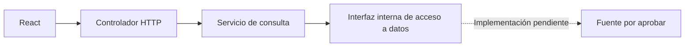
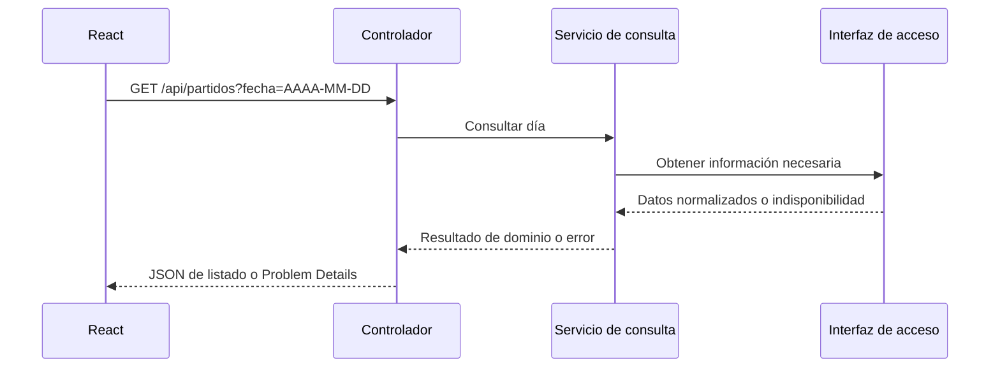

# Boxscore — Diseño técnico inicial

| Control | Valor |
|---|---|
| Versión | 1.0 |
| Fecha | 01/11/2026 |
| Responsable | Diego Gómez Sánchez — responsable del proyecto y desarrollador |
| Estado | Estructura, rutas, contrato base, errores y pruebas iniciales confirmados; implementación e integración pendientes |

## 1. Propósito y referencias

Definir el mínimo técnico del incremento de listado diario y detalle, sin ampliar el alcance ni decidir una integración de datos.

Referencias del repositorio:
- `REQUISITOS.md` 1.0, commit `5a8ce5498349058df0dce05dac7a66eeaffaaf53`.
- `DISENO_UX.md` 1.1, commit `3d86ef73c87f8d0329996aca83910b96e28c590b`.
- Documentos maestros de contexto y estado leídos antes de esta preparación. Conservan pendientes y no se actualizan automáticamente al publicar este archivo.

Aprobaciones: confirmaciones expresas del responsable en la conversación del 01/11/2026 sobre separación interna, dos rutas, contrato base y bloque de respuestas HTTP y primeras pruebas. Este archivo consolida esos acuerdos; no acredita validación externa ni ejecución de pruebas.

Los nombres de clases, firmas Java, esquema JSON completo del detalle, códigos de error adicionales y versiones no presentados para aprobación siguen pendientes. Los ejemplos son ilustrativos, no datos deportivos reales.

## 2. Decisiones y límites

Confirmado como punto de partida:
- Una aplicación Spring Boot, organizada internamente; sin microservicios añadidos.
- React consulta exclusivamente el contrato HTTP de Boxscore descrito aquí, sin recibir directamente tablas o JSON particulares de la biblioteca evaluada.
- Separación de controlador, servicio de consulta e interfaz interna de acceso a datos.
- Dos rutas de lectura; la fecha del listado es opcional.
- Valores desconocidos como `null`, ceros válidos como `0` e identificadores como texto opaco.
- Errores diferenciados de consultas correctas vacías y primeras pruebas del apartado 9.

No aprobado mediante este documento: `nba_api`, un componente Python, fuente o proveedor, acceso automatizado definitivo, versiones concretas, esquema de base de datos, caché, alojamiento, cuentas o autenticación. PostgreSQL sigue como tecnología provisional; no se crean tablas para justificar su uso.

## 3. Responsabilidades

| Parte | Responsabilidad |
|---|---|
| React | Presentar listado y detalle; conservar contexto de navegación; representar ausencias y estados conforme al diseño UX. |
| Controlador HTTP | Recibir parámetros, entregar respuestas y traducir resultados y errores al contrato HTTP; separar datos públicos de detalles internos. |
| Servicio de consulta | Aplicar reglas de Boxscore: temporada, fecha española, solo finalizados, no duplicación y tratamiento de información ausente. |
| Interfaz de acceso a datos | Expresar las operaciones necesarias sin depender de una biblioteca o proveedor específico. |
| Implementación de acceso | Obtener y transformar datos de una fuente que se apruebe posteriormente. Forma y tecnología pendientes. |

La interfaz es un contrato interno de Java, no otro servidor. La distribución exacta de métodos y paquetes se concretará al implementar.



No se dibuja una base de datos como paso obligatorio: persistencia y caché requieren justificación y revisión de condiciones de uso.

## 4. Operaciones internas conceptuales

1. Localizar el último día de la temporada actual con partidos finalizados.
2. Consultar los partidos finalizados de un día.
3. Consultar el detalle de un partido.

El contrato interno no prescribe que cada operación equivalga a una petición de red. Deben concretarse cobertura, identificación de temporada y límite de búsqueda antes de integrar datos reales. No buscar indefinidamente ni confundir cobertura desconocida con ausencia de partidos.

## 5. Contrato HTTP confirmado

### 5.1 Rutas

| Petición | Resultado |
|---|---|
| `GET /api/partidos` | Último día con finalizados de temporada actual y su listado. |
| `GET /api/partidos?fecha=2026-10-31` | Finalizados del día indicado según España peninsular. |
| `GET /api/partidos/{id}` | Detalle del encuentro seleccionado. |

Las dos primeras filas corresponden a la misma ruta con parámetro opcional. Fecha en formato `AAAA-MM-DD`. Fechas futuras o fuera de la temporada admitida no son consultas válidas. La comprobación del día actual utilizará el criterio horario del producto; mecanismo técnico y pruebas de reloj pendientes.

La respuesta declara la fecha efectivamente consultada. Un día explícitamente elegido y vacío no se sustituye por otro.

### 5.2 Listado

Ejemplo ficticio del contrato base confirmado:

```json
{
  "fechaConsultada": "2026-10-31",
  "zonaHoraria": "Europe/Madrid",
  "situacion": "CON_PARTIDOS",
  "partidos": [
    {
      "id": "partido-ejemplo-01",
      "inicioUtc": "2026-10-31T00:00:00Z",
      "local": {
        "id": "equipo-b",
        "nombre": "Equipo B",
        "puntos": 112
      },
      "visitante": {
        "id": "equipo-a",
        "nombre": "Equipo A",
        "puntos": 108
      }
    }
  ]
}
```

| Situación | Significado |
|---|---|
| `CON_PARTIDOS` | Consulta correcta con partidos finalizados. |
| `DIA_SIN_PARTIDOS` | Día consultado conocido, fecha conservada y lista vacía. |
| `TEMPORADA_SIN_FINALIZADOS` | Ausencia comprobada en la temporada, sin fecha encontrada y con lista vacía. |

En ausencia de fecha encontrada, `fechaConsultada` es `null`. Una cobertura que no permita determinar el último día no autoriza a responder `TEMPORADA_SIN_FINALIZADOS`: la consulta no puede completarse y debe diferenciarse como error.

Local y visitante no se deducen del orden de filas. Deben proceder de una identificación explícita de la fuente o de una correspondencia documentada.

### 5.3 Detalle: grupos confirmados

| Grupo | Contenido |
|---|---|
| Identificación | ID, inicio UTC y equipos local y visitante. |
| Competición | Etiquetas disponibles en español y ausencia identificada. |
| Marcador | Resultado de ambos equipos y puntuaciones por periodo. |
| Jugadores | Colección por equipo con los campos confirmados en requisitos. |
| Participación | Participó, no participó o información no disponible; motivo solo respaldado. |
| Disponibilidad | Indicación de detalle incompleto y valores ausentes. |

Campos de jugador: nombre, minutos, puntos, rebotes totales, asistencias, robos, tapones, pérdidas y tiros de campo/triples/libres anotados e intentados. No porcentajes ni avanzadas.

No se fija todavía un JSON exhaustivo del detalle ni nombres de enumeraciones de participación. Su concreción debe respetar estos grupos y documentarse junto al código y las pruebas, sin introducir funcionalidades nuevas.

### 5.4 Tipos y ausencia

- IDs como texto opaco: React conserva y reenvía sin interpretar formato ni depender del proveedor.
- Desconocido: `null`, no cero artificial, cadena vacía o texto visual en campos numéricos.
- Cero válido: `0`.
- React presenta `—`, `No disponible` o el mensaje apropiado según contexto UX.
- No participación solo con respaldo explícito; no inferirla de minutos vacíos o ceros.
- Motivos y categorías se traducen con correspondencias revisadas, no inferencias.

Formato técnico de minutos, estructura de periodos y mapa exhaustivo de nulos por campo quedan pendientes de concretar en implementación y pruebas. La aprobación del contrato base no los convierte en decisiones cerradas.

## 6. Respuestas HTTP

| Situación | Estado |
|---|---|
| Listado correcto con partidos | `200`. |
| Listado correcto vacío o temporada comprobada sin finalizados | `200` con situación correspondiente. |
| Detalle identificable disponible pero incompleto | `200` con disponibles e indicación de incompletitud. |
| Fecha mal formada, futura o fuera de temporada admitida | `400`. |
| Partido confirmado inexistente o fuera de alcance | `404`. |
| No es posible obtener datos o determinar disponibilidad | `503`. |
| Error interno inesperado de Boxscore | `500`, sin detalles internos. |

No convertir un fallo de fuente en `404`, lista vacía o temporada sin encuentros. Una respuesta sin identificación suficiente del encuentro no se presenta como detalle incompleto satisfactorio. El mínimo técnico necesario para identificar y representar el encuentro debe concretarse antes de implementar esta distinción.

## 7. Formato común de error

Formato Problem Details con código estable para React. Ejemplo confirmado:

```json
{
  "type": "about:blank",
  "title": "Servicio no disponible",
  "status": 503,
  "detail": "No se ha podido completar la consulta de partidos.",
  "codigo": "DATOS_NO_DISPONIBLES"
}
```

`codigo` es una extensión estable del contrato. No se han fijado todavía los valores para todos los errores. React conserva los mensajes UX acordados y no expone excepciones, rutas locales, credenciales, URLs privadas o respuestas internas del proveedor.

El mecanismo Spring y las dependencias compatibles se elegirán después de confirmar versiones. Este formato no autoriza instalar bibliotecas adicionales.

## 8. Flujo y fechas



La pertenencia al día se calcula por inicio convertido a `Europe/Madrid`, no por fecha estadounidense o de finalización. No se asume que una única fecha del proveedor cubra todo el día español: selección de consultas necesarias, filtrado, deduplicación y límite de peticiones permanecen pendientes de integración.

El esquema no demuestra consultas ejecutadas ni presupone transporte o persistencia de la implementación de acceso.

## 9. Primeras pruebas confirmadas

| ID | Caso | Resultado esperado |
|---|---|---|
| PT-01 | Fecha válida, inválida, futura y fuera de intervalo. | Consulta admitida o `400` según contrato. |
| PT-02 | Listado con resultados, vacío, temporada sin finalizados y fallo de datos. | Diferenciar situaciones válidas y `503`; no fabricar ausencia a partir de error o cobertura desconocida. |
| PT-03 | Inicio UTC cercano a medianoche y cambio horario. | Agrupación correcta por día de España peninsular. |
| PT-04 | Detalle con prórrogas, ceros, ausencias y no participación. | Campos y estados diferenciados, sin inferencias. |
| PT-05 | Respuestas del controlador. | Rutas, parámetros, contrato JSON y errores acordados. |

Datos ficticios identificados sirven para casos controlados, no prueban cobertura o permiso de una fuente real. Ninguna prueba de esta tabla se declara implementada o superada. Herramientas, firmas, datos de ejemplo exhaustivos y procedimiento se concretarán con el código.

## 10. Evidencia exploratoria revisada

Fuente de evidencia: TXT adjunto y salidas de terminal aportadas por el responsable en la sesión. No están incorporadas como registros originales al repositorio mediante este documento ni contrastadas por ejecución independiente.

- Un encuentro: `0022600022`, marcador MIN 127–LAC 101, estadísticas individuales y parciales de cuatro cuartos en las salidas aportadas.
- Consulta diaria `2026-10-30`: salida con diez partidos finalizados, marcadores y etiquetas de NBA Cup.
- Respuesta original de ese encuentro: `homeTeam` identifica MIN y `awayTeam` identifica LAC; incluye nombres, identificadores, resultados y periodos. No exige detalle adicional únicamente para distinguir local y visitante en este caso.
- Inicio `2026-10-31T00:00:00Z` y conversión local registrada `2026-10-31T01:00:00+01:00`.
- Entorno actual comunicado por comando: Python 3.13.14 y `nba_api` 1.12.0. No acredita retrospectivamente las versiones usadas para producir el TXT anterior.

No se afirma exactitud independiente, cobertura general, estabilidad ni autorización de uso. Un jugador con minutos vacíos y ceros no acredita no participación explícita.

Pendientes de verificación: prórrogas reales, no participación explícita y motivos, otras fases, agrupación completa por día español y búsqueda inicial limitada. No repetir las pruebas ya aportadas salvo necesidad concreta.

Antes de publicar originales, retirar rutas de usuario y otros datos personales o secretos innecesarios. El TXT no se sube en esta operación.

## 11. Seguridad, privacidad y restricciones

Validar entradas y separar los errores públicos de detalles internos. No exponer credenciales o rutas locales. No incorporar cuentas, autenticación o alojamiento mediante este diseño.

Antes de integrar datos reales, revisar acceso automatizado, visualización, atribución, almacenamiento y condiciones de uso aplicables. Uso local o privado no equivale a permiso por sí solo. No es asesoramiento jurídico.

Privacidad de entrevistas pendiente según datos que se recojan. No afirmar cumplimiento del RGPD por una medida aislada ni registrar datos personales que no se necesiten.

## 12. Pendientes de implementación y seguimiento

1. Versiones de Java/Spring Boot, herramientas y dependencias, tras comprobar entorno y compatibilidad.
2. Fuente, biblioteca, integración y condiciones de uso; Python no aprobado como componente.
3. Esquema completo del detalle, minutos, periodos, nulos, códigos de error y límites de identificación.
4. Identificación de temporada, reloj y límite de búsqueda; consultas por día español.
5. Traducciones y categorías revisadas; identidad y deduplicación.
6. Decidir y justificar persistencia/caché y papel de PostgreSQL; no existe esquema de BD aprobado.
7. Implementar y registrar las primeras pruebas; después ampliar según riesgos y datos reales.
8. Concretar accesibilidad técnica, rendimiento, Docker Compose y CI/CD de forma progresiva; sin afirmar que ya estén implementados.

No se crea una issue ni se cambia el tablero mediante este documento. El estado maestro anterior todavía refleja la preparación previa al cierre de issue #1 y a los documentos UX/técnico; requiere conciliación autorizada posterior. Las copias del Project no se sincronizan automáticamente ni se sustituyen aquí.

## 13. Asistencia e historial

Asistencia de IA para estructurar y redactar. Revisión y aprobación bajo responsabilidad del responsable del proyecto. No sustituye evidencia, pruebas o autorización externa.

| Versión | Cambio |
|---|---|
| 1.0 | Consolidación de estructura, rutas, contrato base, respuestas y pruebas confirmadas, con evidencia exploratoria y decisiones técnicas pendientes diferenciadas. |
