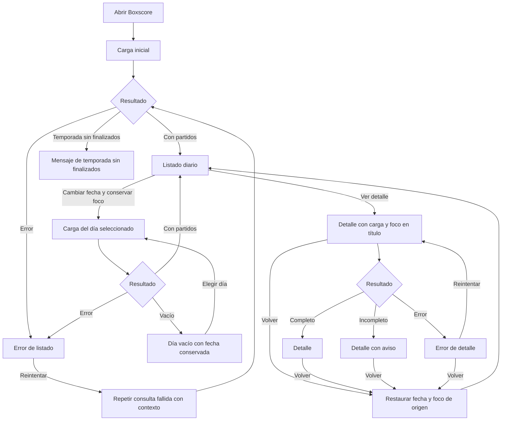

# Boxscore — Diseño de interacción inicial

| Control documental | Valor |
|---|---|
| Versión | 1.1 |
| Fecha | 01/11/2026 |
| Responsable | Diego Gómez Sánchez — responsable del proyecto y desarrollador |
| Estado | Distribución, adaptación, reglas de foco y mensajes confirmados; implementación y verificación pendientes |

## 1. Propósito y referencias

Documentar el diseño de interacción del primer incremento sin añadir funciones ni seleccionar bibliotecas.

- Referencia funcional: `REQUISITOS.md` 1.0, commit `5a8ce5498349058df0dce05dac7a66eeaffaaf53`.
- Bocetos anteriores: `docs/DISENO_UX.md` 1.0, commit `3527a19c2f302a6a30420855f7f727e8501547d8`.
- Aprobaciones: confirmaciones expresas del responsable en la conversación del 01/11/2026 sobre listado, detalle, adaptación, teclado, foco y tres mensajes pendientes. Este archivo consolida esas decisiones, no una validación con participantes externos.
- Issue #1: cierre documental de requisitos comprobado en la sesión; no equivale a incremento implementado.

## 2. Alcance y límites

Dos pantallas: listado diario y detalle. Bocetos textuales, no prototipos ejecutables. Equipos y cifras ficticios, sin evidencia deportiva ni de integración.

Quedan confirmados la distribución, el patrón de adaptación, las reglas de navegación y los mensajes indicados. No se eligen colores, tipografía, componentes, biblioteca de calendario, rutas técnicas ni proveedor de datos. No se acredita accesibilidad completa, conformidad WCAG, implementación o prueba superada.

## 3. UX-01 · Listado diario

### 3.1 Distribución confirmada

Cabecera con nombre de producto y «Resultados NBA». Título «Partidos finalizados», selector de fecha, aclaración de horario y una tarjeta por encuentro. Nombres de visitante y local, resultado y acción «Ver detalle». Fecha siempre visible sobre el listado.

```text
+---------------------------------------------------------+
| BOXSCORE                                                |
| Resultados NBA                                          |
+---------------------------------------------------------+
| Partidos finalizados                                    |
| Fecha: [ 01/11/2026  Calendario ]                        |
| Horario de España peninsular                            |
|                                                         |
| +-----------------------------------------------------+ |
| | Visitante · Equipo A                         108     | |
| | Local     · Equipo B                         112     | |
| |                                    [Ver detalle]    | |
| +-----------------------------------------------------+ |
|                                                         |
| +-----------------------------------------------------+ |
| | Visitante · Equipo C                          95     | |
| | Local     · Equipo D                         101     | |
| |                                    [Ver detalle]    | |
| +-----------------------------------------------------+ |
+---------------------------------------------------------+
```

Ejemplos ficticios. El calendario es orientativo, no un componente elegido. Sin menús, filtros avanzados, logos ni gráficas.

### 3.2 Interacción y estados

Apertura en último día con finalizados de temporada actual. Elegir otra fecha consulta ese día y lo conserva incluso vacío. Abrir detalle del encuentro elegido; volver conserva fecha. No presentar tarjetas anteriores como resultados nuevos.

Cabecera y selector permanecen; cambia la zona de resultados.

| Estado | Presentación confirmada |
|---|---|
| Cargando | «Cargando partidos…». |
| Con resultados | Tarjetas del día consultado. |
| Día vacío | «No hay partidos finalizados para este día». Conservar selección. |
| Error | «No se han podido cargar los partidos» y `Reintentar`, conservando contexto. |
| Temporada sin finalizados | «Todavía no hay partidos finalizados en esta temporada». No buscar años anteriores. |

## 4. UX-02 · Detalle del partido

### 4.1 Distribución confirmada

Vuelta al listado, título, fecha de inicio en España peninsular, competición/fase, marcador, parciales y tablas individuales: visitante y local, una debajo de otra.

```text
+-------------------------------------------------------------+
| BOXSCORE                                                    |
+-------------------------------------------------------------+
| [Volver al listado]                                         |
| Detalle del partido                                         |
| Fecha de inicio: 01/11/2026 · España peninsular               |
| Competición/fase: [Etiqueta disponible]                      |
|                                                             |
| Visitante · Equipo A          108                           |
| Local     · Equipo B          112                           |
|                                                             |
| Puntuación por periodo                                      |
| Equipo       1.º    2.º    3.º    4.º    Total                |
| Equipo A      25     28     27     28      108                |
| Equipo B      30     24     26     32      112                |
|                                                             |
| Estadísticas · Equipo A — Visitante                         |
| [Tabla de jugadores y estadísticas]                         |
|                                                             |
| Estadísticas · Equipo B — Local                             |
| [Tabla de jugadores y estadísticas]                         |
|                                                             |
| — Dato no disponible                                        |
+-------------------------------------------------------------+
```

Ejemplos ficticios. Prórrogas `PR1`, `PR2` y sucesivas entre `4.º` y `Total`, solo si se disputaron. Parcial ausente: `No disponible`.

### 4.2 Tablas individuales

Una tabla por equipo:

```text
Jugador | MIN | PTS | REB | AST | ROB | TAP | PER | TC | T3 | TL
```

| Encabezado | Significado |
|---|---|
| Jugador | Nombre del jugador. |
| MIN | Minutos. |
| PTS | Puntos. |
| REB | Rebotes totales. |
| AST | Asistencias. |
| ROB | Robos. |
| TAP | Tapones. |
| PER | Pérdidas. |
| TC | Tiros de campo anotados/intentos. |
| T3 | Triples anotados/intentos. |
| TL | Tiros libres anotados/intentos. |

Tiros como anotados/intentos, por ejemplo `5/12`, con significado completo identificado mediante encabezados o ayuda accesible, no solo abreviaturas. Estadísticas del partido completo, sin porcentajes, métricas avanzadas ni desglose individual por periodo.

No participantes explícitos al final del equipo como `No participó`, sin ceros artificiales. Motivos solo recibidos y con traducción revisada; no inferir causas. Jugadores ausentes no se añaden por inferencia. Estadística ausente: `—`, con aclaración «Dato no disponible»; cero válido: `0`.

### 4.3 Estados y mensajes confirmados

| Estado | Presentación |
|---|---|
| Cargando | «Cargando detalle…», vuelta disponible. |
| Completo | Marcador, parciales y tablas. |
| Incompleto | Antes de los datos disponibles: «Algunos datos de este partido no están disponibles. Se muestra la información recibida». No ocultar todo el detalle por faltar un campo. |
| Error | «No se ha podido cargar el detalle», `Reintentar` y vuelta disponibles. |
| Competición/fase ausente | `Competición/fase: No disponible`. No inventar categorías. |

Volver conserva fecha, también desde error. No confundir error, ausencia de encuentros y ausencia de un dato.

## 5. Adaptación confirmada

- Tarjetas ocupan el ancho disponible.
- Tablas de equipos una debajo de otra, conservando todos los campos.
- Si una tabla no cabe, desplazamiento horizontal propio dentro de su contenedor; no extender el desplazamiento al resto de la página.
- No ocultar estadísticas ni reducir el texto para forzar que quepan.
- Indicación de desbordamiento: «Desplaza la tabla para ver todas las estadísticas».
- El contenedor desplazable será utilizable con teclado, con foco visible y nombre identificable.

El patrón está confirmado; medidas, implementación y pruebas con anchura reducida y zoom permanecen pendientes. No se afirma que una maqueta textual demuestre adaptación correcta.

## 6. Teclado y gestión del foco confirmados

| Acción | Comportamiento |
|---|---|
| Recorrer listado | Selector de fecha y acciones de detalle en el orden de las tarjetas. |
| Abrir detalle | Llevar foco al título «Detalle del partido». |
| Volver al listado | Conservar fecha y devolver foco a la acción del partido de origen; si ya no aparece, al selector de fecha. |
| Cambiar fecha | Mantener foco en selector y anunciar resultado de consulta. |
| Desplazar tabla | Contenedor operable con teclado, nombre identificable y foco visible. |
| Cargar o reintentar | Comunicar estado sin mover foco automáticamente a cada mensaje. Si desaparece el control enfocado, situarlo en un punto lógico de la misma sección. |

Foco visible y orden coherente. Vuelta disponible durante carga y error del detalle. Los mensajes deben comunicarse también mediante tecnologías de asistencia, no solo visualmente.

Pendiente técnico: implementar estructura semántica, anuncios, identificación inequívoca del botón de cada encuentro y conservación del foco ante cambios de contenido. No se prescribe una API, biblioteca o atributo concreto.

## 7. Recorrido conceptual

Mermaid conceptual, no UML formal ni prueba ejecutada:



Reintentar conserva operación y fecha fallidas, no cambia automáticamente a la inicial. El esquema no prescribe caché ni arquitectura. Si el elemento de origen no existe, aplicar la alternativa de foco del apartado 6.

## 8. Trazabilidad

| Elemento UX | Requisitos |
|---|---|
| Fecha inicial, selección e identificación | RF-01, RF-02, RG-01, RG-05, RC-04. |
| Tarjetas y apertura | RF-03, RF-04. |
| Vuelta con fecha conservada | RF-09, RF-11. |
| Parciales y prórrogas | RF-05, RG-04. |
| Competición/fase y ausencia | RF-06, RG-03, RG-09, RF-12. |
| Tablas, ausencias y no participación | RF-07, RF-12, RG-06, RG-07, RG-08. |
| Consulta según interacción | RF-08. |
| Vacío y temporada sin finalizados | RF-10, RF-13. |
| Carga, error y parcial | RF-11, RF-14, RF-15. |
| Adaptación, foco y comunicación | RC-01 a RC-04; decisiones UX adicionales del 01/11/2026. |

La trazabilidad no equivale a haber superado las condiciones de aceptación.

## 9. Verificación pendiente

Comprobaciones futuras, no realizadas:
- Recorrido por teclado con foco visible y vuelta al encuentro de origen; alternativa si desaparece.
- Cambio de fecha, reintento y carga sin saltos de foco injustificados.
- Anuncios de carga, resultados y errores con tecnología de asistencia.
- Tablas con encabezados y significado completo de abreviaturas.
- Anchura reducida y zoom: campos conservados, texto legible y desplazamiento limitado a la tabla.
- Contenedores desplazables utilizables con teclado sin impedir salir de ellos.
- Mensajes exactos de los apartados 3 y 4 y estados diferenciados.

Quedan para implementación o diseño visual: semántica, mecanismo de foco, contraste, tamaños, tipografía, medidas y control de fecha. No requieren elegir bibliotecas en este documento ni reabrir las distribuciones confirmadas sin un motivo concreto.

## 10. Evidencia y gestión

Confirmadas en conversación la distribución, adaptación, reglas de foco y mensajes. No acreditados prototipo navegable, código, pruebas externas, verificación con lector de pantalla/teclado, cobertura de datos o permiso de integración.

Esta revisión modifica solo este documento. No actualiza automáticamente contexto, estado, Projects o issues. El documento maestro de estado todavía refleja la preparación anterior al cierre de issue #1 y a UX; debe conciliarse cuando se autorice su actualización. Las copias previas del Project siguen sin sincronizarse; no se sustituyen mediante esta operación.

No se crean tareas solo por registrar cada detalle. El texto de seguimiento siguiente se conserva como propuesta, sin issue creada ni número asignado.

## 11. Propuesta de tarea de seguimiento

Título: Documentar los bocetos de listado diario y detalle del partido.

Objetivo: conservar distribuciones y reglas confirmadas, relacionadas con requisitos 1.0, sin aprobar integración ni afirmar verificación.

Entregable: `docs/DISENO_UX.md` 1.1.

Lista propuesta, pendiente de revisar el archivo publicado:
- [ ] Verificar publicación.
- [ ] Revisar ambos bocetos y estados.
- [ ] Revisar adaptación, teclado, foco y textos confirmados.
- [ ] Revisar trazabilidad y límites.
- [ ] Mantener pruebas y diseño visual pendientes.

Antes de crear una issue equivalente, comprobar duplicados y obtener autorización específica. Cerrar una eventual tarea documentaría el entregable, no su implementación ni validación externa. No se modifica el tablero aquí.

## 12. Asistencia e historial

Asistencia de IA para estructurar y redactar; revisión y aprobación del responsable del proyecto. No sustituye evidencia técnica ni validación externa.

| Versión | Cambio |
|---|---|
| 1.0 | Bocetos de listado/detalle, estados, Mermaid, trazabilidad y tarea propuesta. |
| 1.1 | Adaptación, foco, teclado y tres mensajes confirmados; pendientes separados de las decisiones ya cerradas. |
