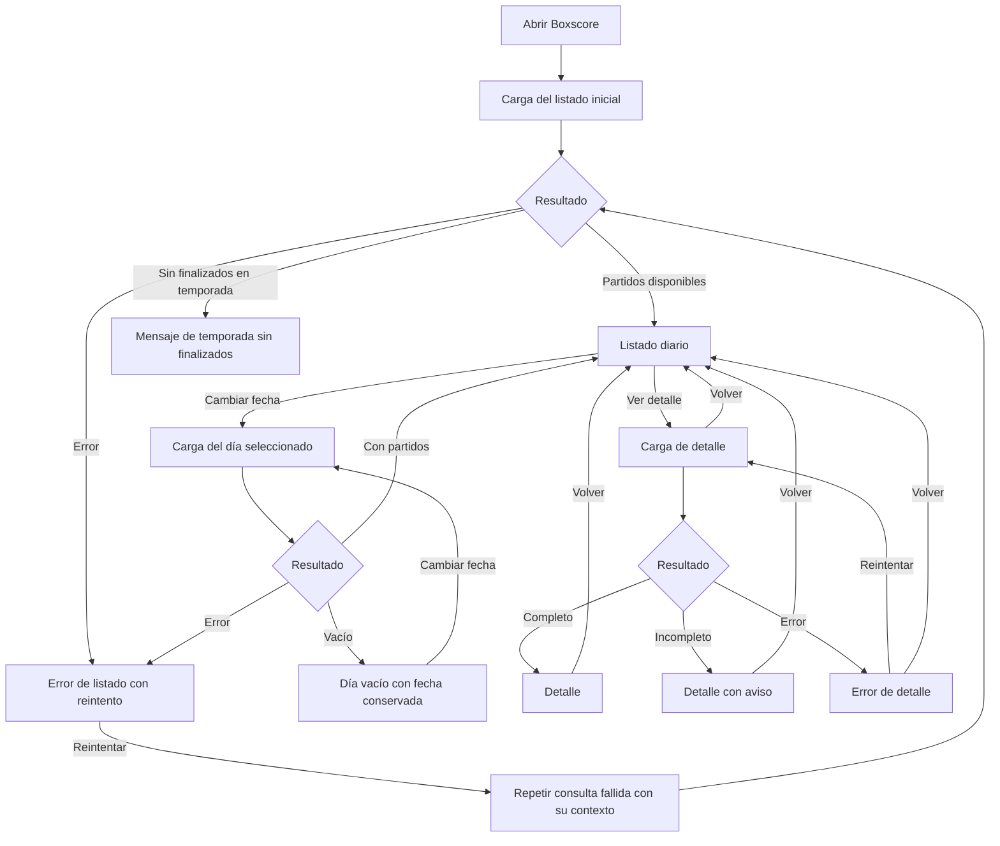

# Boxscore — Diseño de interacción inicial

| Control documental | Valor |
|---|---|
| Versión | 1.0 |
| Fecha | 01/11/2026 |
| Responsable | Diego Gómez Sánchez — responsable del proyecto y desarrollador |
| Estado | Distribución de listado y detalle confirmada; diseño visual, adaptación y verificación pendientes |

## 1. Propósito y referencias

Documentar los bocetos de baja fidelidad del primer incremento, sin añadir funcionalidades ni seleccionar componentes o bibliotecas.

Referencia funcional: `REQUISITOS.md` 1.0, publicado en el commit `5a8ce5498349058df0dce05dac7a66eeaffaaf53`. Los identificadores utilizados a continuación corresponden a esa versión.

Aprobación de distribución: confirmaciones expresas del responsable del proyecto en la sesión del 01/11/2026 para el listado y el detalle. El registro de origen está en la conversación, consolidada en este documento. No representa una prueba con usuarios externos ni una comprobación de accesibilidad.

La issue #1 registra el cierre documental de requisitos y está cerrada como completada según la lectura realizada en la sesión. No implica incremento implementado.

## 2. Límites

- Dos pantallas: listado diario y detalle de partido.
- Bocetos textuales para acordar jerarquía y distribución, no prototipos ejecutables ni diseños finales.
- Sin decisiones de colores, tipografía, componentes, rutas técnicas o bibliotecas.
- Sin ampliación del alcance funcional ni aprobación de fuente, biblioteca de datos, proveedor o alojamiento.
- Ejemplos con equipos, jugadores y cifras ficticios. Las cifras no son evidencia deportiva ni de integración.
- La adaptación a pantallas pequeñas y el procedimiento de evaluación con tecnologías de asistencia siguen pendientes de diseño.

## 3. UX-01 · Listado diario

### 3.1 Distribución confirmada

Cabecera sencilla con nombre de producto y texto «Resultados NBA». Título «Partidos finalizados», selector de fecha y aclaración de horario de España peninsular. Una tarjeta por partido, con equipos identificados como visitante y local, resultado y acción explícita «Ver detalle».

La fecha consultada permanece visible. El símbolo de calendario del boceto es orientativo y no selecciona una biblioteca o un tipo de selector.

```text
+---------------------------------------------------------+
| BOXSCORE                                                |
| Resultados NBA                                          |
+---------------------------------------------------------+
|                                                         |
| Partidos finalizados                                    |
|                                                         |
| Fecha: [ 01/11/2026  Calendario ]                        |
| Horario de España peninsular                            |
|                                                         |
| +-----------------------------------------------------+ |
| | Visitante · Equipo A                         108     | |
| | Local     · Equipo B                         112     | |
| |                                                     | |
| |                                    [Ver detalle]    | |
| +-----------------------------------------------------+ |
|                                                         |
| +-----------------------------------------------------+ |
| | Visitante · Equipo C                          95     | |
| | Local     · Equipo D                         101     | |
| |                                                     | |
| |                                    [Ver detalle]    | |
| +-----------------------------------------------------+ |
+---------------------------------------------------------+
```

Los ejemplos son ficticios. No se incorporan menús, filtros avanzados, logos ni gráficas.

### 3.2 Interacción

- Apertura: último día con partidos finalizados de la temporada actual.
- Cambio de fecha: consultar el día elegido y conservarlo aunque no tenga resultados.
- Selección de encuentro: abrir su detalle.
- Regreso desde detalle: mantener la fecha del listado.
- No presentar tarjetas anteriores como si fueran resultados de una nueva consulta.

### 3.3 Estados

La cabecera y el selector permanecen en los estados del listado; cambia la zona de resultados.

| Estado | Presentación |
|---|---|
| Cargando | «Cargando partidos…». |
| Con resultados | Tarjetas correspondientes al día consultado. |
| Día vacío | «No hay partidos finalizados para este día». Mantener selección y permitir otra fecha. |
| Error | «No se han podido cargar los partidos» y botón `Reintentar`. Conservar el contexto de la consulta fallida. |
| Temporada sin finalizados | Informar de la situación sin buscar temporadas anteriores. El texto literal queda pendiente. |

## 4. UX-02 · Detalle del partido

### 4.1 Distribución confirmada

Botón de vuelta al listado, título, fecha de inicio en España peninsular, competición o fase disponible, marcador, tabla de parciales y dos tablas individuales, una debajo de otra: visitante y local.

```text
+-------------------------------------------------------------+
| BOXSCORE                                                    |
+-------------------------------------------------------------+
| [Volver al listado]                                         |
|                                                             |
| Detalle del partido                                         |
| Fecha de inicio: 01/11/2026 · España peninsular               |
| Competición/fase: [Etiqueta disponible]                      |
|                                                             |
| Visitante · Equipo A          108                           |
| Local     · Equipo B          112                           |
|                                                             |
| Puntuación por periodo                                      |
| Equipo       1.º    2.º    3.º    4.º    Total                |
| Equipo A      25     28     27     28      108                |
| Equipo B      30     24     26     32      112                |
|                                                             |
| Estadísticas · Equipo A — Visitante                         |
| [Tabla de jugadores y estadísticas]                         |
|                                                             |
| Estadísticas · Equipo B — Local                             |
| [Tabla de jugadores y estadísticas]                         |
|                                                             |
| — Dato no disponible                                        |
+-------------------------------------------------------------+
```

Equipos y resultados ficticios. Si existen prórrogas, insertar `PR1`, `PR2` y sucesivas entre `4.º` y `Total`. No mostrar columnas de prórrogas no disputadas. Parcial ausente: `No disponible`.

### 4.2 Tablas individuales

Una tabla por equipo, con las siguientes columnas confirmadas:

```text
Jugador | MIN | PTS | REB | AST | ROB | TAP | PER | TC | T3 | TL
```

| Encabezado | Significado |
|---|---|
| Jugador | Nombre del jugador. |
| MIN | Minutos. |
| PTS | Puntos. |
| REB | Rebotes totales. |
| AST | Asistencias. |
| ROB | Robos. |
| TAP | Tapones. |
| PER | Pérdidas. |
| TC | Tiros de campo anotados/intentos. |
| T3 | Triples anotados/intentos. |
| TL | Tiros libres anotados/intentos. |

Representación de tiros, por ejemplo `5/12`, con significado completo identificado en encabezados o ayuda accesible, no solo abreviaturas. Estadísticas del partido completo, no por periodo ni con porcentajes o métricas avanzadas.

Jugadores explícitamente no participantes al final de la tabla del equipo, con `No participó`, sin rellenar estadísticas con ceros. Motivos solo si existen y tienen traducción revisada. Jugadores ausentes de la respuesta no se añaden por inferencia. Valores estadísticos ausentes: `—`, aclarado como dato no disponible; un cero válido se conserva como `0`.

### 4.3 Estados y navegación

| Estado | Presentación |
|---|---|
| Cargando | «Cargando detalle…», con vuelta al listado disponible. |
| Completo | Marcador, parciales y tablas. |
| Incompleto | Aviso antes de los datos disponibles; aplicar reglas de ausencia sin ocultar todo el detalle por faltar un campo. Texto literal del aviso pendiente. |
| Error | «No se ha podido cargar el detalle», `Reintentar` y vuelta al listado disponibles. |

Volver conserva la fecha del listado, también ante un error. No inventar una competición si falta la etiqueta. Tratamiento visual exacto de una etiqueta ausente pendiente, aplicando la regla funcional de dato no disponible.

## 5. Recorrido de interacción

Diagrama conceptual Mermaid; no es UML formal ni una prueba ejecutada.



El esquema no prescribe arquitectura ni caché. El reintento conserva la operación y fecha que fallaron; no cambia automáticamente al día inicial. La selección sigue disponible en los estados de listado.

## 6. Trazabilidad funcional

| Elemento UX | Requisitos relacionados |
|---|---|
| Fecha inicial, selector e identificación del día | RF-01, RF-02, RG-01, RG-05, RC-04. |
| Tarjetas y apertura del mismo encuentro | RF-03, RF-04. |
| Vuelta conservando fecha | RF-09, RF-11. |
| Parciales y prórrogas | RF-05, RG-04. |
| Etiqueta de competición/fase | RF-06, RG-03, RG-09. |
| Tablas y ausencias/no participación | RF-07, RF-12, RG-06, RG-07, RG-08. |
| Consulta según interacción | RF-08. |
| Día vacío y temporada sin finalizados | RF-10, RF-13. |
| Carga, error, reintento e información parcial | RF-11, RF-14, RF-15. |
| Teclado, foco, texto, encabezados y claridad | RC-01, RC-02, RC-03, RC-04. |

La relación con requisitos no equivale a verificación de sus condiciones de aceptación.

## 7. Accesibilidad y adaptación pendientes

Los bocetos recogen el compromiso de teclado, foco visible, nombres comprensibles, encabezados identificables y comunicación no dependiente solo de imágenes o color. No demuestran su implementación ni conformidad con un nivel WCAG.

Pendiente de diseño y verificación:
- Orden de foco y tratamiento de foco al cambiar de pantalla o reintentar.
- Estructura semántica y anuncio de estados con tecnologías de asistencia.
- Identificación inequívoca del botón de detalle de cada encuentro.
- Adaptación de tarjetas y tablas a anchuras reducidas, sin ocultar campos confirmados. No se ha elegido un patrón concreto.
- Tipografía, contraste, tamaños y controles de fecha.
- Textos literales aún no acordados y presentación de etiquetas ausentes.

Estas cuestiones no justifican introducir bibliotecas, cuentas ni funcionalidades adicionales sin decisión expresa.

## 8. Evidencia y revisión

Confirmado: distribución y contenido descritos a partir de las dos aprobaciones de bocetos. No acreditado: prototipo navegable, implementación, pruebas con usuarios, pruebas de teclado/lector de pantalla, cobertura de datos o permiso de integración.

La publicación de este archivo no modifica automáticamente contexto, estado, Projects ni issues. El estado maestro anterior aún describe la preparación previa al cierre de la issue #1 y a esta documentación UX; ese desfase se registra aquí sin reescribirlo sin autorización específica.

## 9. Propuesta de tarea de seguimiento

Texto listo para revisar, no issue creada. Antes de crearla debe comprobarse que no exista una tarea equivalente y solicitarse autorización específica. No asignar un número previsto.

### Título

Documentar los bocetos de listado diario y detalle del partido

### Cuerpo propuesto

Objetivo: conservar las distribuciones confirmadas del primer incremento y su relación con requisitos 1.0, sin aprobar diseño visual ni integración.

Entregable: `docs/DISENO_UX.md`.

Lista de comprobación propuesta para la issue:
- [ ] Verificar que el documento está publicado en el repositorio.
- [ ] Revisar inclusión de los dos bocetos confirmados.
- [ ] Revisar estados de carga, vacío, error y detalle incompleto.
- [ ] Revisar la trazabilidad de pantallas y elementos a requisitos.
- [ ] Mantener identificados adaptación, accesibilidad detallada y diseño visual como pendientes.

Las casillas se dejan sin marcar hasta revisar el entregable publicado. Cerrar esta tarea documentará la finalización del entregable de bocetos, no su implementación ni su validación con usuarios externos. No se modifica el tablero mediante este documento.

## 10. Asistencia e historial

Asistencia de IA para estructurar y redactar. Revisión y aprobación bajo responsabilidad del responsable del proyecto. No sustituye evidencia técnica ni validación externa.

| Versión | Cambio |
|---|---|
| 1.0 | Consolidación de listado y detalle confirmados, estados, Mermaid, trazabilidad y tarea propuesta. |
