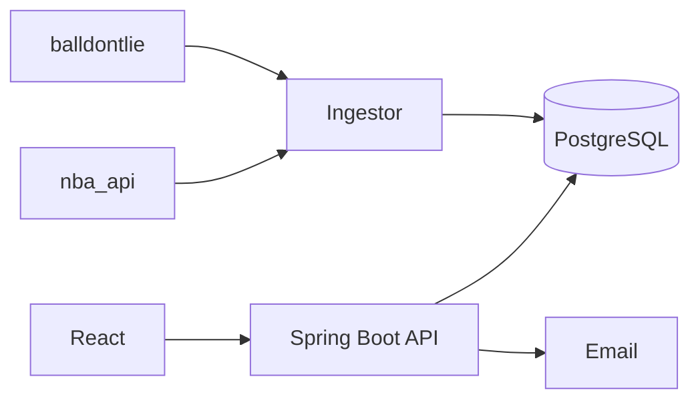

# Boxscore - Contexto del proyecto (documento maestro)

> Pega este archivo al inicio de cada conversacion con la IA. Junto con ESTADO_PROYECTO.md indica donde estamos.
> Ultima actualizacion: 2026-10-31

## 1. Quien soy y como quiero que me ayudes
- Diego Gomez Sanchez, estudiante de Ingenieria Informatica (Jaen, Espana). Responde en espanol, conciso y practico.
- Tengo poca experiencia con estas herramientas: explicame las cosas PASO A PASO y despacio, un paso cada vez, esperando mi confirmacion.
- Prefiero hacer las cosas con interfaz grafica (VS Code, GitHub Desktop, web de GitHub) en lugar de la terminal, salvo que sea imprescindible.
- Cuando haya varias opciones, elige una y justificala en 2 lineas. Dame codigo listo para pegar.
- Objetivo: hacer un sistema software completo "de 0 a 100": entrevista con cliente, requisitos, presupuesto, wireframes y mockups, arquitectura, seguridad, Docker, Kubernetes, implementacion en Java con vibe coding, pruebas y entrega.
- Es un proyecto 100% academico y de formacion. Quiero que sea complejo, con buena informacion y que no falle.

## 2. Idea del producto
Boxscore: portal informativo de baloncesto (NBA), NO es un juego ni fantasy, con cuentas de usuario y zonas.
- Zona publica: calendario, resultados, clasificacion, fichas de equipos y jugadores.
- Usuario registrado: elige su equipo favorito y obtiene el panel "Mi equipo".
- Editor: publica noticias y analisis (fase posterior).
- Administrador: usuarios, roles, contenido, estado de la sincronizacion de datos.
- Descargas: CSV de estadisticas, PDF de informes, calendario .ics.
- Futuro: video/streaming (solo enlaces oficiales), push, app movil.
- Nombre propio sin logos ni marcas de la NBA ni de los equipos.

### Panel "Mi equipo" (el corazon del MVP)
- Proximo partido con cuenta atras en hora de Espana.
- Ultimos 5 resultados y racha.
- Plantilla, lesionados, lideres del equipo.
- Posicion en la conferencia y camino a playoffs.
- Calendario completo del equipo.

### Ideas con "chicha" (por fases)
- Fichas de jugador con historia: temporadas, carrera, mejor partido, comparador de 2-4 jugadores, records historicos.
- Cara a cara entre equipos.
- Alertas por email (partido, record cercano, lesion) y resumen semanal.
- Modo "sin spoilers".
- Noticias, comentarios moderados, guias PDF, linea temporal de franquicias.

## 3. Fases
| Fase | Contenido |
|---|---|
| 1. MVP | Registro/login, elegir equipo, panel Mi equipo, calendario, resultados, fichas de jugador, exportar CSV |
| 2. Chicha | Comparador, records, estadisticas avanzadas, alertas por email, .ics |
| 3. Contenido | Zona editor, noticias, comentarios, PDF |
| 4. Extra | Marcador en vivo, modo sin spoilers, video, push |

## 4. Fuentes de datos (decision tomada)
Usar DOS proveedores con roles distintos y guardar todo en PostgreSQL (la BD es la fuente de verdad; el frontend nunca llama a las APIs externas).
| Dato | Principal | Respaldo |
|---|---|---|
| Equipos, jugadores, calendario, resultados, box scores | balldontlie (clave gratuita) | nba_api |
| Estadisticas avanzadas, historico, records, tiros | nba_api | Calcular desde box scores guardados |
| Marcador en vivo | nba_api (cdn.nba.com) | balldontlie |

Hechos a recordar (comprobados en busquedas, oct 2026):
- balldontlie: plan Free 5 peticiones/min; All-Star 9,99 USD/mes (60/min); GOAT 39,99 USD/mes (600/min). Datos desde 1946, requiere API key gratuita.
- nba_api (Python): cliente NO oficial con 130+ endpoints de stats.nba.com y feeds en vivo de cdn.nba.com.
- Riesgos de nba_api: puede romperse sin aviso (hubo 403 en la CDN por cabeceras), stats.nba.com limita peticiones y suele bloquear IPs de nube (AWS/GCP/Azure). Probar pronto desde donde se desplegara.
- Condiciones de uso no revisadas a fondo; al ser academico no bloquea. Si se hiciera publico/comercial, revisar licencias.

### Diseno anti-fallos
1. BD propia como fuente de verdad; la web sigue funcionando si las APIs caen.
2. Interfaz Java NbaDataProvider con dos implementaciones, fallback y registro de errores.
3. Reintentos con espera creciente y limitador de peticiones.
4. Carga historica inicial separada de la incremental (con progreso guardado).
5. Observabilidad: logs, /actuator/health, pantalla admin con ultima sincronizacion por fuente.
6. Unificar IDs de jugadores/equipos entre proveedores (tabla de equivalencias).

## 5. Actualizacion tras cada partido
1. Job programado (Spring @Scheduled o CronJob de Kubernetes) consulta el calendario 1-2 veces al dia.
2. En dias de partido, otro job consulta el estado cada pocos minutos.
3. Al pasar a "finalizado", se descarga el box score definitivo y se guarda.
4. Se recalculan derivados: medias, rachas, clasificacion, records.
5. Se envian alertas a usuarios que siguen a esos equipos.

## 6. Stack decidido
- Backend: Java 21, Spring Boot 3 (Web, Data JPA, Security, Validation, Actuator), PostgreSQL, Flyway.
- Ingestor: microservicio Python con nba_api (solo importa datos) + cliente Java para balldontlie.
- Frontend: React + TypeScript.
- Auth: Spring Security, JWT, BCrypt/Argon2, roles VISITANTE/USUARIO/EDITOR/ADMIN.
- DevOps: Docker multi-stage, docker-compose, Kubernetes local (kind/minikube): Deployment API, CronJobs de ingesta, StatefulSet PostgreSQL, Ingress, Secrets; CI con GitHub Actions.
- Herramientas: Visual Studio Code (gratis), GitHub Desktop, repo privado en GitHub.
- Docs: Markdown + Mermaid en /docs del repo. Planificacion en GitHub Projects (Tabla, Board, Roadmap, campo Iteracion). Un Project de GitHub NO contiene repos: primero el repo, luego el Project vinculado.

### Arquitectura (Mermaid)


## 7. Estructura del repo (objetivo; se crea poco a poco)
```
boxscore/
  README.md  AGENTS.md  SECURITY.md  CHANGELOG.md  LICENSE
  docs/
    PROYECTO_CONTEXTO.md  ESTADO_PROYECTO.md
    00-contexto/  01-entrevistas/  02-requisitos/  03-presupuesto/
    04-diseno-ux/  05-arquitectura/  06-seguridad/  07-pruebas/
    08-operaciones/  adr/
  backend/  ingestor/  frontend/  deploy/  .github/workflows/
```
Nota: Git no guarda carpetas vacias; se crean al anadir su primer archivo.

## 8. Flujo con Perplexity Pro
- Project (antes Spaces) llamado "Boxscore" con instrucciones del stack y estas reglas. Subir este archivo y ESTADO_PROYECTO.md.
- Un hilo por fase: 00 Contexto, 01 Entrevista, 02 Requisitos, 03 Presupuesto, 04 Diseno, 05 Arquitectura, 06 Seguridad, 07 Datos y normativa.
- Deep Research para normativa (RGPD), comparativas y fuentes de datos; Labs para presupuesto en hoja de calculo; busqueda normal para el resto.
- Cada documento aprobado: guardarlo como .md, subirlo al Project y commitearlo en /docs.
- Al terminar cada sesion: pedir actualizar ESTADO_PROYECTO.md (ver seccion 10).

## 9. Checklist de cosas a plantearse
### Alcance y negocio
- [ ] Definicion de MVP y de "terminado" por fase.
- [ ] Cliente: grupo real de aficionados (propuesto, minimo 3 personas de perfiles distintos) o ficticio.
- [ ] Fecha limite y horas por semana disponibles.
- [ ] Metodologia: Scrum ligero, sprints de 1-2 semanas.
- [ ] Presupuesto: horas por requisito + 20-30 % de margen; costes de infraestructura.
- [ ] Criterios de evaluacion de la asignatura/TFG, si aplica.
### Legal y datos
- [ ] RGPD/LOPDGDD: base legal, politica de privacidad, minimizar datos, derechos de acceso/borrado.
- [ ] Cookies (LSSI) y accesibilidad WCAG 2.1 AA.
- [ ] Licencia del repo y dependencias; terminos de uso de cada API antes de publicar.
- [ ] Contenido de terceros: noticias propias o solo titulares con enlace.
### Tecnico
- [ ] Prueba de concepto de datos: clave de balldontlie + llamadas de prueba; nba_api scoreboard; repetir dentro de Docker.
- [ ] Modelo de datos y unificacion de IDs entre proveedores.
- [ ] Zona horaria (UTC en BD, Europe/Madrid en UI); idioma espanol primero.
- [ ] Autenticacion: registro, verificacion de email, recuperacion de contrasena, refresh tokens, MFA opcional.
- [ ] Secretos en variables de entorno/Kubernetes Secrets, nunca en el repo.
- [ ] Entornos dev/test/prod, backups y restauracion de la BD.
- [ ] Pruebas: unitarias, integracion con Testcontainers, E2E; analisis estatico; Dependabot.
- [ ] Observabilidad, rendimiento (cache, indices, paginacion), emails (Mailpit en local), almacenamiento de archivos y permisos de descarga.
### Proceso y vibe coding
- [ ] AGENTS.md con stack, convenciones y comandos de build/test.
- [ ] Reglas para codigo de IA: revisar, entender, escribir tests, no pegar secretos en prompts.
- [ ] Trazabilidad RF-001 -> issue -> PR -> test.
- [ ] ADRs: dos proveedores de datos, Python para ingesta, BD como fuente de verdad.
- [ ] Gestion de riesgos y plan de mantenimiento.

## 10. Como mantener el historico (regla de oro)
Al final de cada sesion con cualquier IA:
"Actualiza ESTADO_PROYECTO.md: marca lo hecho, anade decisiones nuevas, problemas abiertos y siguientes pasos. Devuelvelo completo en Markdown."
Despues sustituir el archivo en el Project de Perplexity y en el repo (commit "docs: actualiza estado").
Prompt de arranque de cada conversacion nueva:
"Lee PROYECTO_CONTEXTO.md y ESTADO_PROYECTO.md. Resume en 5 lineas donde estamos y propon el siguiente paso."

## 11. Riesgos conocidos
| Riesgo | Impacto | Mitigacion |
|---|---|---|
| nba_api se rompe o bloquea | Alto | Fallback a balldontlie, BD propia, reintentos |
| Limite de 5 peticiones/min | Medio | Cola de peticiones, carga historica lenta y reanudable |
| Alcance excesivo | Alto | Cerrar el MVP antes de abrir fases |
| Datos personales (RGPD) | Medio | Minimizar datos, politica de privacidad, borrado de cuenta |
| Codigo de IA sin entender | Medio | Revision, tests, ADRs |
| Bloqueo de IPs de nube | Medio | Probar pronto el entorno final; ejecutar en local/servidor propio |
