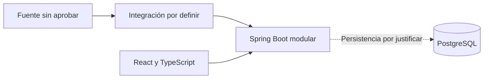

# Boxscore — Contexto del proyecto

| Control | Valor |
|---|---|
| Versión | 5 |
| Fecha | 01/11/2026 |
| Responsable | Diego Gómez Sánchez — responsable del proyecto y desarrollador |
| Revisión | Acuerdos del primer incremento; integración y decisiones técnicas todavía pendientes |

Leer junto con `ESTADO_PROYECTO.md` y `REQUISITOS.md`.

## 1. Estados y reglas

- Confirmado: decisión expresa de producto, con fuente de aprobación identificada; no prueba ni implementación.
- Registrado: criterio previo, provisional cuando así se indicaba.
- Propuesto: contenido pendiente de aprobación.
- Verificado: hecho sustentado por evidencia identificada.
- Pendiente: decisión o comprobación no cerrada.

No convertir propuestas en decisiones. La escritura documental no aprueba proveedores ni implementación. Mantener separadas aprobación de producto, viabilidad técnica y condiciones de uso.

## 2. Marco registrado

Proyecto personal de formación unipersonal, sin supervisión académica ni fecha obligatoria. Objetivo: comprender el ciclo completo, no solo construir una web.

Trabajo por tareas, sin disponibilidad semanal aprobada. El registro de tiempo durante las primeras dos semanas se había previsto; no se acredita aquí su ejecución.

Presupuesto de 0 euros estricto, sin nuevas suscripciones ni pruebas que se conviertan en pago. La suscripción existente de Perplexity queda aparte.

Prioridades: requisitos y alcance; arquitectura y datos; backend; Docker, CI/CD y despliegue. Entrevistas, UX, seguridad, pruebas, presupuesto y mantenimiento forman parte del aprendizaje. Frontend con menor profundidad por experiencia previa; Kubernetes después del MVP.

## 3. Colaboración y documentación formal

Respuestas en español, concisas y prácticas, por pasos y esperando confirmación, salvo encargo completo o petición de agrupar pasos. Preferir Windows 11, VS Code y GitHub Desktop a terminal.

Entregar documentos completos revisados. Redacción técnica e impersonal, adecuada al desarrollo unipersonal, sin narrar el chat ni inventar miembros o revisores. Diferenciar decisiones, propuestas, hechos y pendientes. Registrar asistencia de IA en un apartado específico. No trasladar correcciones editoriales repetitivas al responsable.

Las autorizaciones de escritura son específicas de cada operación; no permanentes.

## 4. Producto e hipótesis

Portal informativo NBA, no juego ni fantasy. Se mantienen sin validación externa documentada las hipótesis de aficionados españoles como público principal, interés secundario en comparaciones e histórico y necesidad de ponerse al día sobre un equipo.

Hipótesis previas: resumen de cambios mediante reglas y plantillas sin IA de pago; evolución visual de equipo y jugadores; explicaciones breves de estadísticas. La posición requiere datos de clasificación actualizados. No son funciones comprometidas del primer incremento.

## 5. Alcance

### 5.1 Candidatos históricos

Selección de equipo sin registro; calendario y resultados; ficha y plantilla condicionada a datos; box score; panel de cambios; una gráfica; explicaciones mínimas y comprobación técnica de actualización. Se conservan como candidatos generales, no como compromisos.

Ampliaciones registradas: cuentas, varios equipos, fichas de jugador, clasificación, gráficas de jugadores, comparador e histórico, alertas, modo sin spoilers, calendario `.ics` y noticias. No están aprobadas para implementar.

### 5.2 Incremento confirmado

Núcleo: listado diario de encuentros finalizados de la temporada actual, elección de fecha y detalle con resultado, parciales y estadísticas individuales de ambos equipos para el partido completo.

Competiciones: temporada regular, NBA Cup incluida su final, play-in y playoffs incluidas las Finales. Excluidos pretemporada, All-Star, Summer League y temporadas anteriores. No duplicar encuentros por etiquetas solapadas. Cuentas, favoritos, directos, noticias y gráficas fuera del núcleo.

Decisiones confirmadas el 01/11/2026: columnas por cuarto y prórroga; tratamiento de ausencias y no participación; carga, errores, reintento y detalle incompleto; fecha por inicio en España peninsular, selección hasta hoy y conservación de fecha; criterios de terminado.

`REQUISITOS.md` 0.5 distingue cada decisión de lo todavía propuesto. No se declara toda la especificación aprobada: quedan campos individuales concretos, categorías, carga bajo demanda y algunos detalles de presentación/calidad por ratificar. La aprobación de producto no garantiza cobertura de datos.

## 6. Validación y privacidad

Priorizar participantes reales, sin número confirmado. No presentar ficticios como evidencia. Registrar hipótesis apoyadas, cuestionadas o pendientes y límites de muestra; preparar guion en paralelo a buscar participantes.

Propuesta: minimizar datos, explicar finalidad y revisar consentimiento, acceso, conservación y anonimización antes de recogerlos. No garantiza por sí solo cumplimiento del RGPD. No se acreditan entrevistas o validación externa en esta revisión.

## 7. Datos y exposición

Prioridad de datos reales con comprobación temprana técnica y de condiciones de uso. `nba_api` es una opción por evaluar, no integración aprobada. Python condicionado a la fuente; sin importador separado aprobado. Datos ficticios solo como apoyo o alternativa explícita identificada.

Los antecedentes de investigación y pruebas de nube se conservan en el histórico; no se revalidan aquí ni se extrapolan al equipo local. No se niegan pruebas posteriores: requieren revisar su registro. No se acreditan versiones, partidos, consultas externas o autorizaciones nuevas.

Revisar acceso automatizado, visualización, atribución, almacenamiento, cobertura, estadísticas completas y actualización antes de aprobar una fuente. Uso local o privado no equivale a permiso. No es asesoramiento jurídico.

Local prioritario; demo privada opcional y condicionada a coste, acceso y condiciones de uso. Publicación abierta no prevista. Una demo ficticia no acredita cobertura real. Mantener nombre propio sin logos ni marcas NBA o de equipos como criterio registrado de partida; cualquier cambio requiere revisión expresa.

## 8. Tecnología provisional

| Área | Criterio registrado |
|---|---|
| Backend | Java con Spring Boot, aplicación única modular. |
| Datos | PostgreSQL de partida; función y persistencia por justificar. |
| Frontend | React con TypeScript. |
| Aprendizaje | Docker Compose y GitHub Actions progresivos; Kubernetes después del MVP. |
| Condicionado | Python según integración. |
| Seguridad inicial | Validación, secretos fuera del repo, cabeceras y protección de comprobaciones técnicas. |
| Aplazado | Cuentas; no excluye cualquier uso de Spring Security. |
| Fuera del alcance actual | JWT, microservicios, dos proveedores, PostgreSQL en Kubernetes; no descartes permanentes. |
| Sin aprobar | Versiones, fuentes, bibliotecas de datos, proveedores y alojamiento. |

Esquema provisional, no implementación ni persistencia aprobada:

## 9. Organización y copias

GitHub es la referencia, sin convertir propuestas en decisiones. Las copias de contexto y estado del Project son respaldo: prevalece el repositorio si difieren. Sin sincronización automática ni actualización obligatoria al terminar sesión.

Modificar documentos maestros cuando se solicite, mostrando texto y esperando confirmación. Avisar de copias desactualizadas; no sustituirlas sin autorización expresa. Si no se puede leer GitHub, usar respaldo advirtiendo vigencia no comprobada y commit conocido.

Uso iniciado de issues y Projects para seguimiento: issue #1 verificada en GitHub. Configuración del tablero, README, vinculación y paso a In Progress comunicados por el responsable; no verificados mediante lectura del tablero. Documentos y Mermaid originales en `docs`, enlazados desde Projects sin duplicación.

Siguen como propuestas: campo de horas reales, trazabilidad completa a PR/pruebas y etiqueta específica de cambio de alcance. No se aprueba el resto de organización en bloque.

## 10. Riesgos y pendientes

- Fuente incompatible o inestable: verificar condiciones y técnica antes de integración.
- Cobertura incompleta: comprobar todas las fases confirmadas y no prometer lo no disponible.
- Alcance excesivo: conservar incremento reducido.
- Evidencia insuficiente: incorporar registros revisados, sin secretos ni datos personales innecesarios.
- Privacidad y código asistido: revisar datos, comprensión y pruebas.
- Ratificaciones restantes en `REQUISITOS.md`; rendimiento y accesibilidad detallada pendientes.

Criterios de terminado de este incremento confirmados en requisitos; los hitos generales y la revisión individual C1–C18 y E1–E7 siguen pendientes. No se incorporan `PLAN_MAESTRO.md`, `VIABILIDAD_DATOS.md` ni `registro_pruebas.json` sin originales revisados.

## 11. Histórico

Versión 4 íntegra: commit `66d8241fb20e37ea0236bc01c2c911577f0591db`, ruta `docs/PROYECTO_CONTEXTO.md`. Conserva el registro anterior de decisiones, referencias y criterios.

Versión 3 y anexos: commit `6855fdd3e6e4b5489fa3005a8ed61c6fa5653307`, misma ruta. SHA correcto del contenido de esa versión: `af03e880b0f6c6c0848835c4a662dd3c2387b806`; corrige la transcripción defectuosa de la versión 4. No aprueba anexos heredados.

## 12. Asistencia

Asistencia de IA para estructurar y redactar. Revisión y aprobación bajo responsabilidad del responsable del proyecto; no sustituye evidencia, pruebas ni autorización externa.
