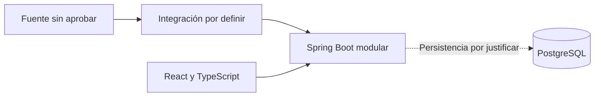

# Boxscore — Contexto del proyecto

| Control | Valor |
|---|---|
| Versión | 6 |
| Fecha | 01/11/2026 |
| Responsable | Diego Gómez Sánchez — responsable del proyecto y desarrollador |
| Revisión | Línea base funcional; diseño e integración pendientes |

Leer junto con `ESTADO_PROYECTO.md` y `REQUISITOS.md`.

## 1. Estados y reglas

- Confirmado: decisión expresa de producto, no prueba ni implementación.
- Registrado: criterio previo, provisional cuando así se indicaba.
- Propuesto: contenido sin aprobar.
- Verificado: hecho con evidencia identificada.
- Pendiente: decisión o comprobación no cerrada.

No convertir propuestas en decisiones. Mantener separadas aprobación de producto, ejecución técnica y condiciones de uso. Escribir documentación no aprueba proveedores ni acredita avances de implementación.

## 2. Marco registrado

Proyecto personal de formación unipersonal, sin supervisión académica ni fecha obligatoria. Objetivo: comprender el ciclo completo. Trabajo por tareas, sin disponibilidad semanal aprobada. Registro de tiempo previsto durante las primeras dos semanas; ejecución no acreditada aquí.

Presupuesto de 0 euros estricto, sin nuevas suscripciones ni pruebas que se conviertan en pago. Suscripción existente de Perplexity aparte.

Prioridades: requisitos y alcance; arquitectura y datos; backend; Docker, CI/CD y despliegue. Entrevistas, UX, seguridad, pruebas, presupuesto y mantenimiento forman parte del aprendizaje. Frontend con menor profundidad por experiencia previa; Kubernetes tras el MVP.

## 3. Colaboración y entregables

Español conciso y práctico; pasos con confirmación, salvo encargo completo o petición de agrupar pasos. Preferir interfaz gráfica en Windows 11, VS Code y GitHub Desktop a terminal.

Entregables completos revisados, lenguaje técnico e impersonal para desarrollo unipersonal, sin narrar el chat ni inventar miembros o revisores. Separar decisiones, propuestas, hechos y pendientes; asistencia de IA en apartado específico. No trasladar correcciones editoriales repetitivas al responsable.

Las autorizaciones de escritura son específicas, no permanentes.

## 4. Producto e hipótesis

Portal informativo NBA, no juego ni fantasy. Hipótesis pendientes de validación externa: aficionados españoles que quieren ponerse al día de su equipo; público secundario interesado en comparaciones e histórico.

Ideas previas no comprometidas: resumen de cambios mediante reglas y plantillas sin IA de pago, evolución visual y explicaciones breves. La posición requiere clasificación actualizada.

## 5. Alcance

### 5.1 Contexto histórico

Candidatos generales: selección de equipo sin registro; calendario y resultados; ficha y plantilla condicionadas a datos; box score; panel de cambios; una gráfica; explicaciones y comprobación de actualización. No son compromisos adicionales de la línea base.

Ampliaciones registradas sin aprobación de implementación: cuentas, varios equipos, fichas de jugador, clasificación, gráficas de jugadores, comparador e histórico, alertas, modo sin spoilers, `.ics` y noticias.

### 5.2 Línea base funcional confirmada

`REQUISITOS.md` 1.0 consolida las confirmaciones del 01/11/2026. Núcleo: listado diario, selección de fecha y detalle de partidos finalizados de temporada actual.

Incluye temporada regular, NBA Cup con su final, play-in y playoffs con Finales; excluye pretemporada, All-Star, Summer League y temporadas anteriores. Sin duplicar encuentros por solapamiento de etiquetas. Cuentas, favoritos, directos, noticias y gráficas fuera del incremento.

Confirmados: cuartos y prórrogas, ausencias/no participación, carga/errores/reintentos, detalle incompleto, fecha por inicio en España peninsular, intervalo hasta hoy, conservación de selección y criterios de terminado.

Ratificación final: listado con nombres local/visitante, resultado y Ver detalle; tablas por equipo con nombre, minutos, puntos, rebotes, asistencias, robos, tapones, pérdidas y tiros anotados/intentos; sin porcentajes o avanzadas. Etiquetas en español sin inferencias; consulta bajo demanda sin descargar todos los detalles. Claridad de fecha/partido, controles comprensibles, encabezados y preparación para tecnologías de asistencia.

La aprobación funcional no garantiza cobertura ni permiso de uso. Categorías y correspondencias técnicas, límites de búsqueda y métodos de prueba siguen pendientes. No se declara accesibilidad completa ni rendimiento aprobado.

## 6. Validación y privacidad

Priorizar participantes reales, sin número confirmado ni ficticios como evidencia. Registrar hipótesis apoyadas, cuestionadas o pendientes y límites de muestra; guion en paralelo a búsqueda de participantes.

Propuesta: minimizar datos y revisar finalidad, consentimiento, acceso, conservación y anonimización antes de recogerlos. No garantiza cumplimiento del RGPD. No se acreditan entrevistas o validación externa en esta revisión.

## 7. Datos y exposición

Datos reales como prioridad de evaluación técnica y de condiciones de uso. `nba_api` es opción, no integración aprobada; Python condicionado, sin importador separado aprobado. Datos ficticios de apoyo o alternativa explícita identificada.

Investigación y pruebas de nube anteriores en histórico, sin revalidar ni extrapolar al entorno local. No se niegan pruebas posteriores: requieren registros revisados. No se acreditan nuevas versiones, partidos, consultas externas o autorizaciones.

Revisar acceso automatizado, visualización, atribución, almacenamiento, cobertura y restricciones de actualización/estadísticas antes de aprobar fuente. Uso local o privado no es permiso por sí solo. No es asesoramiento jurídico.

Local prioritario; demo privada opcional y condicionada a coste, acceso y condiciones. Publicación abierta no prevista. Demo ficticia no acredita cobertura real. Nombre propio sin logos ni marcas NBA o de equipos como criterio registrado; cualquier cambio requiere revisión expresa.

## 8. Tecnología provisional

| Área | Criterio registrado |
|---|---|
| Backend | Java y Spring Boot, aplicación única modular. |
| Datos | PostgreSQL de partida; persistencia por justificar. |
| Frontend | React y TypeScript. |
| Aprendizaje | Docker Compose y GitHub Actions progresivos; Kubernetes tras MVP. |
| Condicionado | Python según integración. |
| Seguridad | Validación, secretos fuera del repo, cabeceras y comprobaciones protegidas. |
| Aplazado | Cuentas; no excluye todo uso de Spring Security. |
| Fuera del alcance actual | JWT, microservicios, dos proveedores y PostgreSQL en Kubernetes; no descartes permanentes. |
| Sin aprobar | Versiones, fuentes, bibliotecas de datos, proveedores y alojamiento. |

Esquema provisional, no implementación ni persistencia aprobada:

## 9. Organización y copias

GitHub es referencia; propuestas conservan estado. Copias del Project como respaldo, prevalece repo si difieren. Sin sincronización automática ni actualización obligatoria al terminar sesión.

Modificar maestros cuando se solicite, mostrando texto y esperando confirmación. Avisar de copias desactualizadas, no sustituirlas sin autorización. Si GitHub falla, usar respaldo avisando vigencia no comprobada y commit conocido.

Uso iniciado de issues y Projects: issue #1 verificada. Configuración del tablero, README, vínculos y paso a In Progress comunicados por el responsable, sin inspección del tablero. Originales de documentos y Mermaid en `docs`, enlazados sin duplicación.

Siguen propuestos el campo de horas reales, trazabilidad completa a PR/pruebas y etiqueta de cambio de alcance. No se aprueba organización restante en bloque.

## 10. Riesgos y pendientes

Fuente incompatible/inestable, cobertura incompleta, alcance excesivo y evidencia insuficiente: evaluar temprano, conservar incremento pequeño y revisar registros sin secretos ni datos personales innecesarios.

Pendientes: cobertura, condiciones, correspondencias, caché/almacenamiento, PostgreSQL, método de accesibilidad, rendimiento y validación externa. Criterios de terminado confirmados no implican que se hayan cumplido.

Hitos generales y revisión individual C1–C18/E1–E7 pendientes. No incorporar plan maestro, viabilidad ni registros externos sin originales revisados. No declarar esos grupos cerrados por esta línea base.

## 11. Histórico

- Versión 5 íntegra: commit `10491535f240c3a0d735059c91247bf61a3e3194`, ruta `docs/PROYECTO_CONTEXTO.md`.
- Versión 4: commit `66d8241fb20e37ea0236bc01c2c911577f0591db`, misma ruta.
- Versión 3 y anexos: commit `6855fdd3e6e4b5489fa3005a8ed61c6fa5653307`, misma ruta. SHA de ese contenido: `af03e880b0f6c6c0848835c4a662dd3c2387b806`. No aprueba anexos.

## 12. Asistencia

Asistencia de IA para estructurar y redactar. Revisión y aprobación del responsable; no sustituye evidencia, pruebas o autorización externa.
