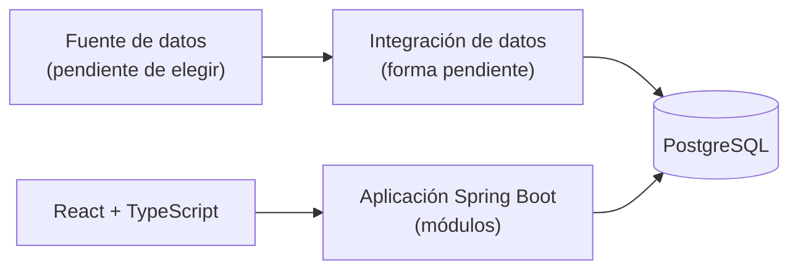

# Boxscore - Contexto del proyecto (documento maestro)

> Léelo junto con `ESTADO_PROYECTO.md` al inicio de cada conversación con una IA.
> Última actualización: 2026-11-01 · Versión 3 (sustituye a la versión 2 del commit `ff2907c`).

## 0. Cómo leer este documento

| Etiqueta | Significado |
|---|---|
| **[Diego]** | Decisión de Diego, **provisional**. Sirve de referencia, pero no está aprobada para implementar. |
| **[Propuesta]** | Sugerencia de una IA o borrador, **sin aprobar**. |
| **[Hecho]** | Verificado con una fuente y una fecha. |
| **[Pendiente]** | Sin resolver. |

Reglas:
- Nada se implementa hasta que exista una decisión expresa de Diego (ADR o indicación directa).
- Una IA **no debe** convertir propuestas en decisiones ni dar avances por hechos sin enlazar la evidencia (commit, PR o archivo).
- **No están aprobados:** las **fuentes y bibliotecas de acceso a datos**, los **proveedores de datos** y el **alojamiento**. El stack elegido (sección 8) es una decisión provisional aparte.
- **Los bloques del MVP son candidatos, no compromisos.**

## 1. Quién soy y cómo quiero que me ayudes

- Diego Gómez Sánchez, estudiante de Ingeniería Informática (Jaén, España). Respuestas en español, concisas y prácticas.
- Explicaciones **paso a paso**, un paso cada vez, esperando mi confirmación.
- Uso Windows 11, VS Code, GitHub Desktop y la web de GitHub. Prefiero interfaz gráfica antes que terminal, salvo que sea imprescindible.
- Cuando haya varias opciones, elige una y justifícala en 2 líneas. Debe quedar claro que es una propuesta.
- No inventes entrevistas, pruebas, avances ni aprobaciones.

## 2. Marco del proyecto [Diego]

- **Tipo:** proyecto personal de formación, sin fecha obligatoria y sin supervisión académica.
- **Objetivo principal:** recorrer y entender el ciclo completo de desarrollo (cliente, requisitos, diseño, presupuesto, implementación, seguridad, pruebas, despliegue y mantenimiento), no solo terminar una web.
- **Tiempo:** trabajo organizado por tareas, sin fechas. Durante las 2 primeras semanas de trabajo registraré el tiempo real para ajustar el alcance. **No hay disponibilidad semanal aprobada.**
- **Presupuesto:** 0 € estricto. Sin suscripciones ni pruebas gratuitas que se conviertan en pago. Lo que requiera pagar se aplaza, se sustituye o se practica con datos ficticios claramente identificados. Mi suscripción de Perplexity queda aparte; no se contrata nada adicional.
- **Prioridades de aprendizaje (más profundidad), en orden:**
  1. Requisitos y alcance.
  2. Arquitectura y modelo de datos.
  3. Backend en Java con Spring Boot.
  4. Docker, CI/CD y despliegue.
- **Resto del ciclo:** entrevistas, UX, seguridad, pruebas, presupuesto y mantenimiento son obligatorios, con entregables prácticos y proporcionados.
- **Frontend:** menos profundidad, porque ya tengo experiencia con React y TypeScript.
- **Kubernetes:** fase de aprendizaje posterior al MVP.

## 3. Producto: hipótesis por validar

Boxscore es un portal informativo de baloncesto NBA. **No es un juego ni un fantasy.** Usará un nombre propio, sin logos ni marcas de la NBA ni de los equipos.

| Elemento | Contenido | Estado |
|---|---|---|
| Público principal | Aficionados españoles que siguen a uno o varios equipos y quieren ponerse al día de forma rápida y personalizada, vean o no los partidos en directo | [Diego] Hipótesis |
| Público secundario | Aficionados que quieren profundizar con comparaciones e histórico; se atenderán progresivamente, según los datos disponibles | [Diego] Hipótesis |
| Núcleo | Seguir a tu equipo y entender cómo está: resultados, calendario, jugadores, estadísticas y evolución | [Diego] Hipótesis |
| Problema | Para saber cómo está su equipo, el aficionado consulta varias fuentes, en inglés y con horario de EE. UU.; le cuesta ponerse al día rápido y entender la evolución más allá del último resultado | [Propuesta] Hipótesis |
| Diferenciador A | "Qué ha cambiado" tras cada partido: resultado, racha, jugadores destacados y próximo encuentro. Generado con reglas y plantillas, sin IA de pago. La posición solo se añade cuando haya clasificación actualizada | [Diego] Hipótesis |
| Diferenciador D | Evolución visual del equipo y de sus jugadores durante la temporada, con gráficas comprensibles y un alcance inicial pequeño | [Diego] Hipótesis |
| Apoyo C | Explicaciones breves de las estadísticas que se muestren, sin convertirlo en otro módulo grande | [Diego] Hipótesis |

## 4. Validación [Diego]

- Primero intentaré conseguir **participantes reales**. Aún no sé cuántos tendré.
- No se presentarán personajes ficticios como evidencia real. Si solo hay 1-2 participantes, se documenta ese alcance limitado.
- El número de participantes no valida nada por sí mismo. Cada hipótesis queda **apoyada, cuestionada o pendiente**, documentando los resultados y sus límites.
- [Propuesta] Pedir consentimiento para tomar notas y anonimizarlas. Son medidas propuestas: **no garantizan por sí solas el cumplimiento del RGPD**. Los requisitos de privacidad se revisarán según los datos que realmente se recojan.
- El guion de entrevista se prepara en paralelo a la búsqueda de participantes.

## 5. Alcance

### 5.1 Candidatos al MVP [Diego]

Son candidatos, **no compromisos**. Se confirmarán según la viabilidad de los datos y el tiempo real.

| Bloque | Alcance |
|---|---|
| Selección de equipo | Un único equipo, sin registro |
| Calendario y resultados | En hora de España, alcance pequeño |
| Ficha de equipo | La plantilla solo si hay datos disponibles |
| Box score | Datos de los jugadores de cada partido |
| Panel "qué ha cambiado" | Resultado, racha, jugadores destacados y próximo partido; sin posición |
| Gráfica de evolución | Una sola, del equipo, limitada al periodo con datos |
| Explicaciones de estadísticas | Mínimas |
| Estado de los datos | Comprobación técnica de cuándo se actualizaron y si hubo errores; sin panel de administración |

### 5.2 Para después [Diego]

- Cuentas de usuario.
- Seguir varios equipos.
- Ficha de jugador.
- Clasificación y posición.
- Gráficas de jugadores.
- Comparador e histórico.
- Alertas.
- Modo sin spoilers.
- Calendario `.ics`.
- Noticias.

## 6. Exposición [Diego]

- **Prioridad:** una versión funcional en local.
- **Demo privada en Internet: opcional y condicionada.** Sería para enseñarla a los participantes de la validación, solo si es viable con alojamiento gratuito, acceso restringido y las condiciones de uso de la fuente elegida. Ningún servicio está aprobado.
- Si la demo no puede usar datos reales, usará **datos ficticios claramente identificados**, y se mantendrá separada de la validación de hipótesis.
- Publicación abierta: no prevista.

## 7. Datos

### 7.1 Estrategia [Diego]

- **Datos reales primero.**
- La **primera tarea de ejecución** será comprobar pronto la viabilidad técnica (calendario, resultados y box scores) **y** las condiciones de uso de la fuente, antes de construir el resto sobre ella.
- **nba_api es una opción por probar, no una decisión.** No se da por viable ninguna integración hasta haberla probado.
- Si la fuente falla o tiene limitaciones importantes, se revisan las alternativas y el alcance.
- Los datos ficticios son un recurso de apoyo para pruebas, o una alternativa explícita; no son el punto de partida.

### 7.2 Hechos y evidencia (consultados el 2026-10-31)

Cada punto cita su evidencia. `VIABILIDAD_DATOS.md` amplía el detalle, pero es un borrador generado con IA y **todavía no está disponible en el repo**.

- **nba_api**: según su [README](https://github.com/swar/nba_api) (consultado el 2026-10-31), es un cliente Python no oficial, no requiere clave, advierte que stats.nba.com no responde a muchas IP de nube e indica que los datos están sujetos a los Términos de Uso de NBA.com. [Hecho]
- **nba_api y lesiones:** no aparece ningún endpoint de lesiones en su [guía de endpoints](https://github.com/swar/nba_api/blob/master/docs/nba_api/stats/endpoint_guide.md) (2026-10-31). Es una conclusión por ausencia. [Pendiente de verificación]
- **balldontlie**: según su [documentación](https://docs.balldontlie.io/) (consultada el 2026-10-31), el plan gratuito (5 peticiones/min) solo incluye equipos, jugadores y partidos; las estadísticas por partido, los box scores, la clasificación, las lesiones y los mapas de tiros son de pago. [Hecho]
- **Pruebas del 31-10-2026:** 3 consultas a nba_api desde un sandbox en la nube, ejecutadas por la IA; según su registro, las 3 fallaron. Evidencia: `registro_pruebas.json` (22:14 UTC), **todavía no disponible en el repo**. **No es concluyente** para mi PC ni para otro entorno. [Pendiente de verificación]

### 7.3 Condiciones de uso [Pendiente]

Según los [Términos de Uso de NBA.com](https://www.nba.com/termsofuse) (versión del 13-07-2026, consultada el 2026-10-31), las estadísticas:
- exigen atribución visible a NBA.com;
- solo pueden usarse para noticias o fines privados no comerciales;
- no pueden usarse, sin consentimiento, en servicios con una base de datos de estadísticas completas y actualizadas regularmente, ni en servicios que muestren el partido jugada a jugada en vivo, casi en vivo o archivado.

**Que el uso sea local o una demo privada no lo convierte en permitido.** Queda pendiente aclarar:
- Si guardar calendario, resultados y box scores de una temporada encaja en la prohibición de "base de datos completa y actualizada".
- Si enseñar la demo a los participantes cuenta como uso privado o como exhibición pública.
- Si existen condiciones específicas para el acceso automatizado a stats.nba.com y cdn.nba.com fuera de esa página.
- Qué condiciones tendría cualquier alternativa que se estudie.

Esto no es asesoramiento jurídico.

## 8. Tecnologías [Diego]

| Categoría | Contenido |
|---|---|
| Stack elegido para este proyecto (no imprescindible para cualquier producto similar) | Java + Spring Boot · PostgreSQL · React + TypeScript · Git y GitHub |
| Aprendizaje prioritario, incorporado pronto y de forma progresiva | Docker Compose · GitHub Actions |
| Condicionado | Python, solo si la fuente o biblioteca elegida lo necesita |
| Desde el principio | Seguridad mínima: validación de entradas, secretos fuera del repo, cabeceras, protección de la comprobación técnica |
| Aplazado | El sistema de cuentas (no cualquier uso de Spring Security) |
| Después del MVP | Kubernetes |
| Fuera del alcance actual (no descartado para siempre) | JWT · microservicios · dos proveedores · PostgreSQL en Kubernetes |
| Herramientas de trabajo | VS Code · GitHub Desktop |
| Documentación | Markdown + Mermaid en `/docs` |
| [Pendiente] (no aprobado) | Fuentes y bibliotecas de acceso a datos · proveedores de datos · alojamiento de la demo · versiones concretas (incluida Java 21 o 25) |

## 9. Arquitectura de partida [Diego]

Punto de partida: **una aplicación Spring Boot única organizada en módulos**. La integración de los datos se concretará después de probar la fuente; **no hay aprobado un importador separado**.



## 10. Forma de trabajar

### 10.1 Documentación y copias [Diego, 2026-11-01]

- GitHub (`/docs` del repo `DiegoGSUJA/boxscore`) es la fuente de referencia para la documentación aprobada y el estado registrado del proyecto.
- Estar en GitHub no convierte una hipótesis o propuesta en decisión aprobada: cada contenido conserva su etiqueta.
- Los archivos `PROYECTO_CONTEXTO.md` y `ESTADO_PROYECTO.md` del Project de Perplexity son copias de respaldo. Si difieren de GitHub, prevalece el repositorio.
- No hay sincronización automática ni actualizaciones obligatorias al terminar cada sesión. Los documentos se actualizan solo cuando Diego lo solicita, revisando antes el texto.
- Cuando Diego autorice un cambio en cualquiera de estos dos documentos, la IA indicará si las copias del Project quedan desactualizadas. Sustituirlas requiere autorización expresa, que puede darse en la misma petición.
- Si no se puede consultar GitHub, se usan las copias del Project, avisando de que su vigencia no está comprobada e indicando el commit de referencia si se conoce.

### 10.2 Resto de la organización [Propuesta, no aprobada]

- Issues para el trabajo y GitHub Projects solo como vista.
- Campo "Horas reales" en las issues.
- Trazabilidad necesidad → requisito → issue → PR → prueba.
- Cambios de alcance mediante issues con la etiqueta `cambio-alcance`.
- Reglas de uso de IA.

## 11. Pendientes

- Revisar **una a una** las correcciones C1-C18 y E1-E7 propuestas en `PLAN_MAESTRO.md`. **No se aplican en bloque.** Este documento refleja parcialmente algunos de sus temas (ver `ESTADO_PROYECTO.md`, sección "Correcciones reflejadas parcialmente"). Ninguna está resuelta del todo.
- Decidir si `VIABILIDAD_DATOS.md`, `PLAN_MAESTRO.md` y `registro_pruebas.json` (generados con IA) se guardan en `/docs`. **Todavía no están disponibles en el repo.**
- Guion de entrevista y búsqueda de participantes.
- Comprobación temprana de datos reales y de las condiciones de uso.
- Definición de "terminado" e hitos propios.
- Revisar el contenido heredado del Anexo A.

## 12. Riesgos [Propuesta, pendiente de revisar]

Esta tabla **no es una decisión aprobada**. Fusiona los riesgos de la versión 1 con lo decidido.

| Riesgo | Impacto | Mitigación propuesta |
|---|---|---|
| La fuente falla, se bloquea o cambia | Alto | Comprobarlo pronto; BD propia; revisar alternativas y alcance |
| Condiciones de uso incompatibles con el uso previsto | Alto | Revisarlas antes de construir; datos ficticios identificados en la demo si es necesario |
| Alcance excesivo, al no haber fecha límite | Alto | Candidatos pequeños; registro del tiempo real; hitos propios |
| Datos personales (entrevistas) | Medio | Medidas propuestas (sección 4); revisar el RGPD según los datos reales |
| Código de IA sin entender | Medio | Revisión, pruebas y explicación propia de cada cambio |
| Bloqueo de IP de nube | Medio | Probar desde el entorno real |

---

## Anexo A. Contenido heredado de la versión 1 (sin revisar)

> Se copia **literalmente** de la versión 1 (commit `d7895e2`) para no perder información. **Todo el anexo es contenido histórico pendiente de revisión: no contiene decisiones ni instrucciones vigentes.**
> - A.1 (v1 §5) · pendiente de C11
> - A.2 (v1 §7) · propuesta
> - A.3 (v1 §8) · pendiente de C17
> - A.4 (v1 §9) · pendiente de C18
> - A.5 (v1 §10) · histórico; sustituido por la sección 10.1
> - A.6 (v1 §2) y A.7 (v1 §3) · ideas iniciales de producto y fases; **no son requisitos**. Lo elegido está en las secciones 3 y 5.
>
> Las secciones v1 §1, §4, §6 y §11 se sustituyen por las secciones 1, 7, 8 y 12 de esta versión. Su texto sigue disponible en el historial de Git (commit `d7895e2`).

### A.1 (v1) Actualizacion tras cada partido
1. Job programado (Spring @Scheduled o CronJob de Kubernetes) consulta el calendario 1-2 veces al dia.
2. En dias de partido, otro job consulta el estado cada pocos minutos.
3. Al pasar a "finalizado", se descarga el box score definitivo y se guarda.
4. Se recalculan derivados: medias, rachas, clasificacion, records.
5. Se envian alertas a usuarios que siguen a esos equipos.

### A.2 (v1) Estructura del repo (objetivo; se crea poco a poco)
```
boxscore/
  README.md  AGENTS.md  SECURITY.md  CHANGELOG.md  LICENSE
  docs/
    PROYECTO_CONTEXTO.md  ESTADO_PROYECTO.md
    00-contexto/  01-entrevistas/  02-requisitos/  03-presupuesto/
    04-diseno-ux/  05-arquitectura/  06-seguridad/  07-pruebas/
    08-operaciones/  adr/
  backend/  ingestor/  frontend/  deploy/  .github/workflows/
```
Nota: Git no guarda carpetas vacias; se crean al anadir su primer archivo.

### A.3 (v1) Flujo con Perplexity Pro
- Project (antes Spaces) llamado "Boxscore" con instrucciones del stack y estas reglas. Subir este archivo y ESTADO_PROYECTO.md.
- Un hilo por fase: 00 Contexto, 01 Entrevista, 02 Requisitos, 03 Presupuesto, 04 Diseno, 05 Arquitectura, 06 Seguridad, 07 Datos y normativa.
- Deep Research para normativa (RGPD), comparativas y fuentes de datos; Labs para presupuesto en hoja de calculo; busqueda normal para el resto.
- Cada documento aprobado: guardarlo como .md, subirlo al Project y commitearlo en /docs.
- Al terminar cada sesion: pedir actualizar ESTADO_PROYECTO.md (ver seccion 10).

### A.4 (v1) Checklist de cosas a plantearse
#### Alcance y negocio
- [ ] Definicion de MVP y de "terminado" por fase.
- [ ] Cliente: grupo real de aficionados (propuesto, minimo 3 personas de perfiles distintos) o ficticio.
- [ ] Fecha limite y horas por semana disponibles.
- [ ] Metodologia: Scrum ligero, sprints de 1-2 semanas.
- [ ] Presupuesto: horas por requisito + 20-30 % de margen; costes de infraestructura.
- [ ] Criterios de evaluacion de la asignatura/TFG, si aplica.
#### Legal y datos
- [ ] RGPD/LOPDGDD: base legal, politica de privacidad, minimizar datos, derechos de acceso/borrado.
- [ ] Cookies (LSSI) y accesibilidad WCAG 2.1 AA.
- [ ] Licencia del repo y dependencias; terminos de uso de cada API antes de publicar.
- [ ] Contenido de terceros: noticias propias o solo titulares con enlace.
#### Tecnico
- [ ] Prueba de concepto de datos: clave de balldontlie + llamadas de prueba; nba_api scoreboard; repetir dentro de Docker.
- [ ] Modelo de datos y unificacion de IDs entre proveedores.
- [ ] Zona horaria (UTC en BD, Europe/Madrid en UI); idioma espanol primero.
- [ ] Autenticacion: registro, verificacion de email, recuperacion de contrasena, refresh tokens, MFA opcional.
- [ ] Secretos en variables de entorno/Kubernetes Secrets, nunca en el repo.
- [ ] Entornos dev/test/prod, backups y restauracion de la BD.
- [ ] Pruebas: unitarias, integracion con Testcontainers, E2E; analisis estatico; Dependabot.
- [ ] Observabilidad, rendimiento (cache, indices, paginacion), emails (Mailpit en local), almacenamiento de archivos y permisos de descarga.
#### Proceso y vibe coding
- [ ] AGENTS.md con stack, convenciones y comandos de build/test.
- [ ] Reglas para codigo de IA: revisar, entender, escribir tests, no pegar secretos en prompts.
- [ ] Trazabilidad RF-001 -> issue -> PR -> test.
- [ ] ADRs: dos proveedores de datos, Python para ingesta, BD como fuente de verdad.
- [ ] Gestion de riesgos y plan de mantenimiento.

### A.5 (v1) Como mantener el historico (regla de oro)
Al final de cada sesion con cualquier IA:
"Actualiza ESTADO_PROYECTO.md: marca lo hecho, anade decisiones nuevas, problemas abiertos y siguientes pasos. Devuelvelo completo en Markdown."
Despues sustituir el archivo en el Project de Perplexity y en el repo (commit "docs: actualiza estado").
Prompt de arranque de cada conversacion nueva:
"Lee PROYECTO_CONTEXTO.md y ESTADO_PROYECTO.md. Resume en 5 lineas donde estamos y propon el siguiente paso."

### A.6 (v1) Idea del producto
Boxscore: portal informativo de baloncesto (NBA), NO es un juego ni fantasy, con cuentas de usuario y zonas.
- Zona publica: calendario, resultados, clasificacion, fichas de equipos y jugadores.
- Usuario registrado: elige su equipo favorito y obtiene el panel "Mi equipo".
- Editor: publica noticias y analisis (fase posterior).
- Administrador: usuarios, roles, contenido, estado de la sincronizacion de datos.
- Descargas: CSV de estadisticas, PDF de informes, calendario .ics.
- Futuro: video/streaming (solo enlaces oficiales), push, app movil.
- Nombre propio sin logos ni marcas de la NBA ni de los equipos.

#### Panel "Mi equipo" (el corazon del MVP)
- Proximo partido con cuenta atras en hora de Espana.
- Ultimos 5 resultados y racha.
- Plantilla, lesionados, lideres del equipo.
- Posicion en la conferencia y camino a playoffs.
- Calendario completo del equipo.

#### Ideas con "chicha" (por fases)
- Fichas de jugador con historia: temporadas, carrera, mejor partido, comparador de 2-4 jugadores, records historicos.
- Cara a cara entre equipos.
- Alertas por email (partido, record cercano, lesion) y resumen semanal.
- Modo "sin spoilers".
- Noticias, comentarios moderados, guias PDF, linea temporal de franquicias.

### A.7 (v1) Fases
| Fase | Contenido |
|---|---|
| 1. MVP | Registro/login, elegir equipo, panel Mi equipo, calendario, resultados, fichas de jugador, exportar CSV |
| 2. Chicha | Comparador, records, estadisticas avanzadas, alertas por email, .ics |
| 3. Contenido | Zona editor, noticias, comentarios, PDF |
| 4. Extra | Marcador en vivo, modo sin spoilers, video, push |
