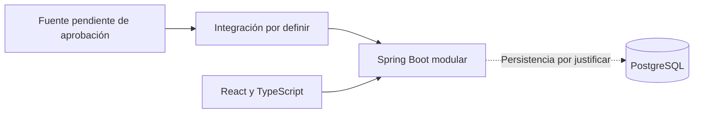

# Boxscore — Contexto del proyecto

| Control | Valor |
|---|---|
| Versión | 4 |
| Fecha | 01/11/2026 |
| Responsable | Diego Gómez Sánchez — responsable del proyecto y desarrollador |
| Naturaleza de esta revisión | Consolidación documental; no aprobación de implementación ni de proveedores |

Leer junto con `ESTADO_PROYECTO.md` y `REQUISITOS.md`.

## 1. Estados y reglas

- Registrado: criterio recogido en el contexto anterior; conserva su carácter provisional, salvo aprobación expresa documentada.
- Propuesto: contenido pendiente de aprobación.
- Hecho verificado: actuación con evidencia identificada.
- Pendiente: decisión, comprobación o evidencia todavía no cerrada.

No convertir propuestas en decisiones ni presentar pruebas, entrevistas, autorizaciones o avances sin evidencia. La autorización para actualizar documentación no aprueba los requisitos funcionales ni permite dar por implementada la aplicación.

## 2. Marco del proyecto

Criterios registrados de partida:

- Proyecto personal de formación y desarrollo unipersonal, sin supervisión académica ni fecha obligatoria.
- Objetivo: comprender el ciclo completo de ingeniería de software, no solo construir una web.
- Trabajo por tareas, sin disponibilidad semanal aprobada. Se había previsto registrar el tiempo real durante las dos primeras semanas de trabajo; su ejecución no está acreditada.
- Presupuesto de 0 euros estricto. No contratar servicios adicionales ni pruebas que se conviertan en pago. La suscripción existente de Perplexity queda fuera del presupuesto del proyecto.
- Prioridades: requisitos y alcance; arquitectura y datos; backend; Docker, CI/CD y despliegue.
- Entrevistas, UX, seguridad, pruebas, presupuesto y mantenimiento forman parte del aprendizaje previsto, con entregables proporcionados.
- Frontend con menor profundidad por experiencia previa en React y TypeScript. Kubernetes se aplaza hasta después del MVP.

## 3. Forma de colaboración y redacción

Criterios expresados por el responsable del proyecto:

- Respuestas en español, concisas y prácticas. Explicaciones de un paso cada vez, esperando confirmación, salvo encargo expreso de una actuación completa.
- Preferir interfaz gráfica: Windows 11, VS Code y GitHub Desktop.
- Cuando existan opciones, formular una propuesta concreta y justificarla brevemente.
- Entregar documentos completos y revisados, no trasladar al responsable una sucesión de correcciones manuales por errores de redacción.
- Redactar entregables en estilo técnico e impersonal, adecuado a un equipo unipersonal. No narrar la conversación ni atribuir miembros, departamentos o revisores inexistentes.
- Distinguir decisiones, propuestas, hechos y pendientes mediante estados y trazabilidad. La redacción formal no sustituye a la evidencia.
- Registrar la asistencia de IA en un apartado específico cuando corresponda, no dispersarla por cada requisito.

El 01/11/2026 se solicitó realizar directamente en GitHub la actualización documental de esta sesión para recuperarla después mediante pull. Este encargo no constituye una autorización permanente para futuras escrituras.

## 4. Producto e hipótesis

Boxscore es un portal informativo de baloncesto NBA; no es un juego ni un fantasy.

Hipótesis registradas, no validadas con participantes externos en esta revisión:

| Elemento | Hipótesis |
|---|---|
| Público principal | Aficionados españoles que siguen uno o varios equipos y desean ponerse al día de forma rápida y personalizada. |
| Público secundario | Aficionados interesados en comparaciones e histórico, sujetos a los datos disponibles. |
| Núcleo de producto | Seguir un equipo y comprender resultados, calendario, jugadores, estadísticas y evolución. |
| Problema propuesto | Información dispersa entre fuentes, en inglés y con horario estadounidense. |
| Diferenciador A | Resumen de cambios después de cada partido mediante reglas y plantillas, sin IA de pago; posición solo si existe clasificación actualizada. |
| Diferenciador D | Evolución visual del equipo y jugadores con un alcance inicial reducido. |
| Apoyo C | Explicaciones breves de las estadísticas mostradas. |

Las hipótesis generales no implican que todas esas funciones deban entrar en el primer incremento.

## 5. Alcance y requisitos

### 5.1 Candidatos registrados al MVP

Selección de un equipo sin registro; calendario y resultados en hora de España; ficha de equipo y plantilla condicionada a los datos; box score; panel de cambios; una gráfica de evolución; explicaciones mínimas; comprobación técnica de actualización y errores. Son candidatos, no compromisos.

Ampliaciones registradas: cuentas, varios equipos, fichas de jugador, clasificación, gráficas de jugadores, comparador e histórico, alertas, modo sin spoilers, calendario `.ics` y noticias. No están aprobadas para implementar.

### 5.2 Primer incremento propuesto

`REQUISITOS.md` concreta una propuesta más pequeña: listado diario de partidos finalizados de la temporada actual y detalle con resultado, parciales y estadísticas individuales. Incluye reglas propuestas sobre fechas en España peninsular y consulta bajo demanda.

Estado: borrador. Debe conciliarse con los candidatos anteriores antes de aprobar una línea base. Su incorporación no elimina las hipótesis de producto ni convierte todos los requisitos en decisiones.

## 6. Validación y privacidad

- Priorizar participantes reales, sin número confirmado. No presentar personajes ficticios como evidencia.
- Registrar qué hipótesis quedan apoyadas, cuestionadas o pendientes y los límites de la muestra.
- Preparar el guion en paralelo a la búsqueda de participantes.
- Propuesta: minimizar notas personales, explicar su finalidad y revisar consentimiento, acceso, conservación y anonimización antes de recoger datos. Estas medidas no garantizan por sí solas cumplimiento del RGPD.

No se acredita en esta revisión la realización de entrevistas ni una validación externa.

## 7. Datos y exposición

### 7.1 Estrategia registrada

Prioridad de datos reales con comprobación temprana de viabilidad técnica y condiciones de uso. `nba_api` es una opción por evaluar, no una integración aprobada. Python queda condicionado a la fuente. No existe un importador separado aprobado. Los datos ficticios sirven como apoyo de pruebas o alternativa explícita y deben identificarse.

### 7.2 Evidencia y antecedentes

La versión anterior contiene investigación sobre `nba_api`, balldontlie y términos de NBA.com, además de referencias a tres pruebas fallidas desde un sandbox en la nube del 31/10/2026. Sus registros externos no se han incorporado ni revisado en esta actualización. Se conserva la referencia histórica en el apartado 11; esos antecedentes no se revalidan aquí ni permiten concluir viabilidad en el equipo local.

No se afirma que no existan pruebas locales posteriores: su resultado y entorno requieren contrastar el registro correspondiente. No se acreditan en esta revisión versiones de herramientas, partidos concretos, consultas externas enviadas ni autorizaciones recibidas.

### 7.3 Condiciones pendientes

Antes de aprobar una fuente deben aclararse condiciones de acceso automatizado, visualización, atribución y almacenamiento para el uso previsto. También deben revisarse las restricciones sobre estadísticas completas, actualización y datos en directo. No se reproducen como condiciones vigentes conclusiones jurídicas no revalidadas en esta sesión.

El uso local o privado no constituye por sí mismo permiso. Este documento no es asesoramiento jurídico.

### 7.4 Exposición y recursos

- Versión local prioritaria. Publicación abierta no prevista.
- Demo privada opcional, condicionada a coste, acceso restringido y condiciones de uso. Alojamiento pendiente de aprobación.
- Si fuera necesario usar datos ficticios en una demo, identificarlos y no confundir esa demostración con validación de datos reales.
- Criterio registrado de partida: nombre propio, sin logos ni marcas NBA o de equipos. Cualquier cambio requiere decisión expresa y revisión de derechos.

## 8. Tecnología y arquitectura provisional

| Área | Criterio registrado |
|---|---|
| Backend | Java y Spring Boot; aplicación única organizada en módulos. |
| Datos | PostgreSQL como tecnología de partida; función concreta y persistencia pendientes de diseño. |
| Frontend | React y TypeScript. |
| Aprendizaje prioritario | Docker Compose y GitHub Actions, incorporados de manera progresiva. |
| Condicionado | Python si lo requiere la integración elegida. |
| Seguridad desde el inicio | Validación de entradas, secretos fuera del repositorio, cabeceras y protección de comprobaciones técnicas. |
| Aplazado | Sistema de cuentas; no implica excluir cualquier uso de Spring Security. |
| Fuera del alcance actual | JWT, microservicios, dos proveedores y PostgreSQL en Kubernetes; no son descartes permanentes. |
| Sin aprobar | Versiones concretas, fuentes, bibliotecas de acceso a datos, proveedores y alojamiento. |

Esquema conceptual provisional, no arquitectura implementada ni flujo de persistencia aprobado:

## 9. Documentación y copias

- GitHub, en `DiegoGSUJA/boxscore`, es la referencia documental. Estar en el repositorio no aprueba propuestas.
- Los documentos de contexto y estado del Project de Perplexity son copias de respaldo. Si difieren, prevalece GitHub.
- No hay sincronización automática ni actualización obligatoria al terminar cada sesión.
- Contexto y estado se modifican cuando se solicita, mostrando antes el texto y esperando confirmación.
- Tras cambiarlos, indicar que las copias previas del Project quedan desactualizadas. No sustituirlas sin autorización expresa.
- Si GitHub no puede consultarse, usar las copias del Project avisando de que su vigencia no está comprobada e indicando el commit de referencia si se conoce.

Siguen como propuestas sin aprobar: issues como unidad de trabajo, GitHub Projects como vista, campo de horas reales, trazabilidad necesidad → requisito → issue → PR → prueba y cambios de alcance mediante etiqueta específica.

## 10. Riesgos y pendientes

| Riesgo o pendiente | Tratamiento propuesto |
|---|---|
| Alcance excesivo | Aprobar un incremento pequeño y registrar esfuerzo real. |
| Fuente inestable o incompatible | Verificar pronto técnica y condiciones; revisar alcance o alternativas. |
| Restricciones de nube | No extrapolar resultados entre entornos. |
| Evidencia insuficiente | Incorporar registros revisados sin secretos ni datos personales innecesarios. |
| Privacidad en entrevistas | Revisar datos recogidos, finalidad, conservación y acceso. |
| Código generado sin comprensión | Revisión, explicación propia y pruebas de cada cambio. |
| Requisitos sin conciliar | Revisar diferencias antes de aprobar implementación. |

Siguen pendientes la definición de terminado, hitos propios, entrevistas y la revisión individual de C1–C18 y E1–E7. No se declaran resueltas en bloque. `PLAN_MAESTRO.md`, `VIABILIDAD_DATOS.md` y `registro_pruebas.json` no están incorporados mediante esta actualización.

## 11. Histórico y trazabilidad de la consolidación

La versión 3 completa, incluidos sus anexos heredados y referencias originales, se conserva en el commit anterior a esta actualización:

- Commit: `6855fdd3e6e4b5489fa3005a8ed61c6fa5653307`.
- Ruta: `docs/PROYECTO_CONTEXTO.md`.
- SHA del contenido anterior: `af03e880b0f6c6c0845 83 5c4a662dd3c2387b806`.

La referencia válida para recuperar el histórico es el commit y la ruta. Esta consolidación sustituye la reproducción de anexos por esa referencia para separar contexto vigente y material heredado; no aprueba los anexos. Las referencias antiguas a `d7895e2` y `ff2907c` permanecen en ese histórico.

## 12. Asistencia automatizada

Se ha utilizado asistencia de IA para estructurar y redactar documentación. La responsabilidad de revisión y aprobación corresponde al responsable del proyecto. La asistencia no acredita hechos externos ni sustituye pruebas o revisión de condiciones de uso.
