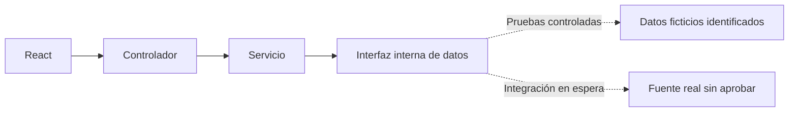

# Boxscore — Contexto del proyecto

| Control | Valor |
|---|---|
| Versión | 7 |
| Fecha | 01/11/2026 |
| Responsable | Diego Gómez Sánchez — responsable del proyecto y desarrollador |
| Revisión | Preparación inicial consolidada; paso a entorno y backend, integración real en espera |

Leer con `ESTADO_PROYECTO.md`, `REQUISITOS.md`, `DISENO_UX.md`, `DISENO_TECNICO.md` y `VIABILIDAD_DATOS.md`.

## 1. Estados y responsabilidad

Confirmado: decisión expresa, no implementación ni prueba. Registrado: criterio previo, provisional cuando correspondía. Propuesto: sin aprobar. Verificado: evidencia identificada. Pendiente: decisión o comprobación abierta.

Separar producto, ejecución técnica y condiciones de uso. No inventar entrevistas, resultados, autorizaciones o avances. La aprobación de este paquete no aprueba fuente, biblioteca, proveedor, alojamiento o código inexistente.

## 2. Marco registrado

Proyecto personal de formación unipersonal, sin supervisión académica ni fecha obligatoria. Objetivo: practicar el ciclo completo. Trabajo por tareas, sin disponibilidad semanal aprobada. Registro de tiempo previsto para primeras dos semanas; ejecución no acreditada aquí.

Presupuesto de 0 euros estricto: sin suscripciones nuevas ni pruebas que se conviertan en pago. Suscripción existente de Perplexity aparte.

Prioridades de profundidad: requisitos y alcance; arquitectura/modelo de datos; backend; Docker, CI/CD y despliegue. Entrevistas, UX, seguridad, pruebas, presupuesto y mantenimiento forman parte del ciclo con entregables proporcionados. Frontend con menor profundidad por experiencia previa; Kubernetes tras el MVP.

## 3. Colaboración y entregables

Español conciso y práctico. Pasos con confirmación, salvo petición expresa de agrupar o completar un bloque. Preferir interfaz gráfica de Windows 11, VS Code y GitHub Desktop; terminal solo cuando aporta una comprobación concreta.

Documentos completos, revisados, técnicos e impersonales para desarrollo unipersonal. Sin narración del chat ni miembros ficticios. Asistencia de IA en apartado específico. No trasladar correcciones editoriales sucesivas al responsable ni reabrir acuerdos sin motivo.

Encargo del 01/11/2026: completar de manera agrupada el bloque de preparación y pasar a ejecución. No es autorización permanente para escrituras futuras. Agrupar cambios coherentes y obtener aprobación del contenido exacto antes de publicarlos.

## 4. Producto e hipótesis

Portal NBA, no juego ni fantasy. Hipótesis pendientes de validación externa: aficionados españoles que quieren ponerse al día de su equipo; público secundario interesado en comparaciones e histórico.

Ideas previas no comprometidas: resumen de cambios mediante reglas y plantillas sin IA de pago, evolución visual y explicaciones. Posición condicionada a clasificación actualizada.

Candidatos históricos no añadidos al incremento: selección de equipo, ficha/plantilla, panel de cambios, gráfica, explicaciones y estado técnico de actualización. Ampliaciones sin aprobar: cuentas, varios equipos, ficha de jugador, clasificación, comparador, histórico, alertas, modo sin spoilers, `.ics` y noticias.

## 5. Línea base y diseño confirmados

Núcleo: listado diario, fecha y detalle de finalizados de la temporada actual. Incluye temporada regular, NBA Cup con final, play-in y playoffs con Finales; excluye pretemporada, All-Star, Summer League y años anteriores. Sin duplicar encuentros por etiquetas solapadas. Fuera del incremento cuentas, favoritos, directos, noticias, gráficas, porcentajes y avanzadas.

`REQUISITOS.md` 1.0 recoge listado local/visitante, resultado, detalle, cuartos/prórrogas, campos individuales, ausencias, no participación, carga/error/reintento, fecha española, conservación de selección y criterios de terminado. Aprobación no implica que dichos criterios se hayan cumplido.

`DISENO_UX.md` 1.1: tarjetas y dos tablas de equipos apiladas; desplazamiento horizontal limitado a tablas, campos conservados; teclado, foco, regreso al origen y mensajes definitivos. Distribución y reglas confirmadas, sin conformidad WCAG demostrada, diseño visual final o pruebas ejecutadas.

`DISENO_TECNICO.md` 1.0: aplicación única modular; controlador, servicio e interfaz interna sustituible de datos. `GET /api/partidos` con fecha opcional y `GET /api/partidos/{id}`. Contrato base propio, nulos diferenciados de cero, errores HTTP/Problem Details y primeras pruebas. JSON exhaustivo de detalle y mecanismos se concretarán con el código, sin añadir funciones.

Esquema de partida, no código implementado. PostgreSQL no se incorpora como paso obligatorio del flujo.

## 6. Datos y conclusión de la revisión

Prioridad histórica: datos reales con evaluación temprana técnica y de condiciones. Las salidas locales aportadas muestran viabilidad exploratoria de listado y un detalle, no cobertura completa ni derechos de uso. Entorno actual comunicado: Python 3.13.14 y `nba_api` 1.12.0; no prueba retrospectiva del entorno del TXT anterior.

`VIABILIDAD_DATOS.md` distingue evidencias, límites y fuentes públicas consultadas el 01/11/2026. Hallazgo: FAQ oficial de NBA Stats restrictiva sobre descarga personal/académica; términos con atribución y restricciones, incluidas bases completas regularmente actualizadas con consentimiento previo. La licencia MIT de `nba_api` no licencia los datos NBA. No se declara una prohibición jurídica definitiva ni autorización por uso privado.

Conclusión operativa de este paquete: no integrar ni efectuar nuevas consultas NBA para el producto hasta aclarar y aprobar el uso. Preparar entorno y núcleo del backend con casos ficticios identificados para pruebas. Es una separación temporal del trabajo técnico, no sustitución silenciosa del producto por una demo ficticia ni cierre del incremento real.

`nba_api`, Python como componente, fuente y proveedor siguen sin aprobar. No eludir bloqueos ni añadir importadores periódicos. Borrador de consulta disponible, no enviado; no se acredita envío anterior ni respuesta recibida.

## 7. Exposición, seguridad y privacidad

Local prioritario; demo privada opcional y condicionada a coste, acceso y condiciones. Publicación abierta no prevista. Sin autorización de logos o marcas; nombre propio y ausencia de afiliación. Demo ficticia identificada no valida integración real.

Seguridad inicial: validación de entradas, secretos fuera del repo, cabeceras y comprobaciones técnicas protegidas; no se afirma implementación. Antes de subir registros retirar rutas personales y secretos. El TXT original no se publica.

Validación: participantes reales, sin número confirmado; guion y búsqueda en paralelo, sin ficticios como evidencia. Registrar hipótesis y límites. Revisar finalidad, consentimiento cuando proceda, conservación, acceso y minimización antes de recoger datos; ninguna medida aislada garantiza RGPD. No se acreditan entrevistas.

## 8. Tecnología provisional

Java/Spring Boot modular; PostgreSQL de partida, persistencia por justificar; React/TypeScript. Docker Compose y GitHub Actions progresivos. Python solo si se aprueba una integración que lo requiera. Cuentas aplazadas, sin excluir todo uso de Spring Security.

JWT, microservicios, dos proveedores y PostgreSQL en Kubernetes fuera del alcance actual, no descartes permanentes. Versiones, dependencias, caché, esquema BD, alojamiento y proveedores pendientes. La preparación del entorno empieza por comprobar lo instalado, sin contratar servicios.

## 9. Organización y copias

GitHub es referencia; la publicación no convierte propuestas en decisiones. Contexto y estado del Project son respaldo: prevalece repo si difieren. No hay sincronización automática ni actualización obligatoria al terminar sesión.

Actualizar maestros solo con encargo, texto previo y confirmación. Avisar de copias desactualizadas y no sustituirlas sin autorización expresa. Si GitHub no puede leerse, usar respaldo con aviso de vigencia no comprobada y commit conocido.

Issue #1 cerrada como completed, comprobada en GitHub. Tablero creado según captura; configuración y paso a In Progress comunicados por el responsable, no inspeccionados mediante conector. No afirmar que el cierre movió la tarjeta a Done.

Documentos y Mermaid originales en `docs`, enlazados desde Projects. Borradores de tareas y de actualización de issue dentro de documentos son registros de preparación, no tareas automáticamente creadas ni instrucciones operativas vigentes que deban repetirse. No crear trabajo retrospectivo solo para cada apartado.

Campo de horas, trazabilidad completa a PR/pruebas y etiqueta específica de cambios de alcance siguen como propuestas, no aprobación en bloque de toda la organización.

## 10. Trabajo pendiente y cierre del bloque

Preparación inicial suficiente para comenzar el entorno y núcleo del backend; no equivale a proyecto completado. No se exige otra ronda de microdecisiones de texto, pantallas o JSON antes de ejecutar. Detalles de código se resolverán y probarán de manera agrupada.

Pendientes reales: aclaración de condiciones, integración/cobertura, versiones, código, modelo detallado, persistencia justificada, pruebas, accesibilidad, rendimiento, entrevistas, presupuesto/tiempo, Docker/CI/CD y operación mínima. Kubernetes después.

Hitos generales y C1–C18/E1–E7 conservan revisión individual; no se declaran cerrados por esta consolidación. Planes/registros externos ausentes no se reconstruyen ni incorporan como originales.

## 11. Histórico y asistencia

Contexto 6 íntegro anterior a esta actualización: commit `23702e677a20820c0183101bea35091a46067030`, ruta `docs/PROYECTO_CONTEXTO.md`. Versiones anteriores y anexos recuperables mediante referencias conservadas en ese histórico.

Asistencia de IA para estructura y redacción. Revisión y aprobación bajo responsabilidad del responsable del proyecto; no sustituye pruebas, evidencia o autorización externa.
