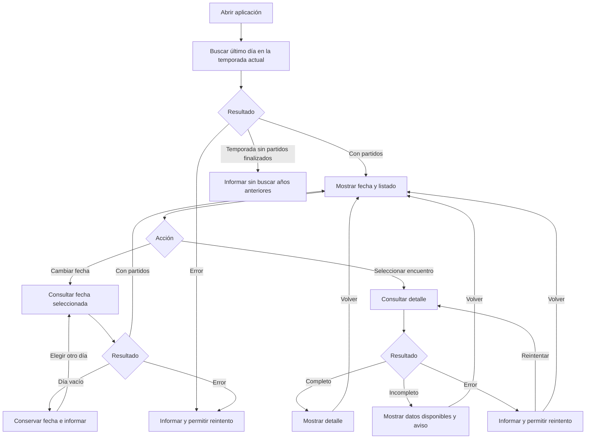

# Boxscore — Requisitos del primer incremento

| Control | Valor |
|---|---|
| Versión | 0.5 |
| Fecha | 01/11/2026 |
| Responsable | Diego Gómez Sánchez — responsable del proyecto y desarrollador |
| Estado | Alcance y comportamientos indicados como confirmados; especificación técnica y viabilidad de datos pendientes |

## 1. Propósito y trazabilidad

Especificar el incremento de consulta diaria de partidos finalizados y detalle de un encuentro. Proyecto formativo de desarrollo unipersonal.

Referencias:
- Documentos anteriores: commit `66d8241fb20e37ea0236bc01c2c911577f0591db`, rutas `docs/REQUISITOS.md`, `docs/PROYECTO_CONTEXTO.md` y `docs/ESTADO_PROYECTO.md`.
- Fuente de aprobación: confirmaciones expresas del responsable del proyecto en la sesión del 01/11/2026, sobre núcleo, competiciones, prórrogas, participación, estados de consulta, fechas y criterios de terminado. El registro de origen está en la conversación; este documento lo consolida. No constituye validación con usuarios externos.
- Seguimiento: issue #1, «Concretar y aprobar los requisitos del primer incremento».

Confirmado significa decisión de producto, no implementación, prueba superada ni aprobación de una fuente. Pendiente identifica detalles no resueltos. El contenido heredado no confirmado se conserva como propuesta.

## 2. Necesidad y objetivos

N-01: facilitar la consulta de resultados y estadísticas mediante una interfaz de listado y detalle. La utilidad para participantes externos sigue pendiente de contraste.

OBJ-01: seleccionar un día, localizar un encuentro finalizado, consultar su detalle y volver al listado.

OBJ-02: practicar trazabilidad entre requisitos, interacción, arquitectura, datos, implementación y pruebas sin añadir funciones únicamente para justificar una tecnología.

## 3. Restricciones registradas

Presupuesto de 0 euros, prioridad local y demo privada opcional y condicionada. Sin fecha obligatoria ni disponibilidad semanal confirmada. Stack provisional: Java con Spring Boot, PostgreSQL y React con TypeScript; Docker Compose y GitHub Actions prioritarios para aprendizaje. Fuentes, bibliotecas de acceso a datos, proveedores, versiones y alojamiento siguen sin aprobar.

El uso local o privado no constituye por sí solo permiso para utilizar datos o recursos de terceros.

## 4. Alcance confirmado

### 4.1 Incluido

Partidos finalizados de la temporada actual correspondientes a temporada regular, NBA Cup incluida su final, play-in y playoffs incluidas las Finales. Consulta diaria y detalle de encuentro con resultado, parciales y estadísticas individuales de ambos equipos para el partido completo.

No duplicar un mismo encuentro por estar asociado a más de una competición o fase. La correspondencia concreta de categorías, identificadores y estados de la fuente queda pendiente.

### 4.2 Excluido del primer incremento

Pretemporada, All-Star, Summer League y temporadas anteriores. Cuentas, favoritos, directos, noticias y gráficas quedan fuera del núcleo confirmado. Las restantes exclusiones del borrador anterior se mantienen como propuesta: vistas semanales o mensuales, filtros avanzados, vídeos, alertas e importación periódica. No son descartes permanentes.

Las hipótesis generales del portal se conservan como contexto futuro, no como compromisos de este incremento.

## 5. Requisitos funcionales

Todos se relacionan con N-01 y OBJ-01. Se conserva la numeración anterior.

| ID | Requisito | Estado |
|---|---|---|
| RF-01 | Al abrir, mostrar el último día con partidos finalizados de la temporada actual, su fecha y listado. | Confirmado |
| RF-02 | Permitir seleccionar cualquier día de esa temporada hasta el día actual y mostrar únicamente sus partidos finalizados. | Confirmado |
| RF-03 | Identificar ambos equipos y mostrar el resultado final en cada elemento del listado. | Especificación propuesta del núcleo; pendiente de ratificación detallada |
| RF-04 | Permitir abrir el detalle del encuentro seleccionado. | Confirmado |
| RF-05 | Mostrar resultado y parciales de ambos equipos con cuatro columnas fijas de cuartos, una por cada prórroga disputada y el total. | Confirmado |
| RF-06 | Mostrar competición o fase mediante una correspondencia documentada, sin inferir categorías sin respaldo. | Propuesto; categorías técnicas pendientes |
| RF-07 | Mostrar estadísticas individuales de ambos equipos para el partido completo. | Alcance confirmado; campos concretos propuestos en el apartado 6 |
| RF-08 | Consultar listado y detalle bajo demanda, sin descargar anticipadamente todos los detalles. | Propuesto; caché y persistencia pendientes |
| RF-09 | Conservar la fecha al volver del detalle al listado. | Confirmado |
| RF-10 | Mantener el día seleccionado y mostrar «No hay partidos finalizados para este día» si no contiene resultados. No saltar automáticamente a otra fecha. | Confirmado |
| RF-11 | Diferenciar error de consulta y ausencia de partidos. Mostrar reintento; conservar la fecha del listado y permitir volver desde un detalle fallido. | Confirmado |
| RF-12 | Distinguir datos ausentes, ceros válidos y no participación según el apartado 7. | Confirmado |
| RF-13 | Si todavía no existen partidos finalizados en la temporada, informar sin buscar temporadas anteriores. La búsqueda no será indefinida. | Comportamiento confirmado; mecanismo y límites técnicos pendientes |
| RF-14 | Mostrar «Cargando partidos…» o «Cargando detalle…» durante la consulta, sin presentar datos anteriores como los nuevos. | Confirmado |
| RF-15 | Si el detalle es incompleto, mostrar lo disponible y advertir de la información incompleta. | Confirmado |

## 6. Estadísticas individuales

El alcance confirmado comprende estadísticas del partido completo, sin desglose individual por periodo.

Se conserva como propuesta del borrador la siguiente selección de campos: minutos, puntos, rebotes totales, asistencias, robos, tapones, pérdidas, tiros de campo anotados e intentados, triples anotados e intentados y tiros libres anotados e intentados. La aprobación del núcleo no se interpreta como ratificación individual de esta selección; debe confirmarse antes de cerrar RF-07.

## 7. Reglas confirmadas y detalles pendientes

| ID | Regla | Estado |
|---|---|---|
| RG-01 | Asignar el día por la fecha de inicio convertida a `Europe/Madrid`, no por la fecha estadounidense ni por la finalización. | Confirmado |
| RG-02 | Incluir únicamente partidos finalizados. | Confirmado; correspondencia con estados de fuente pendiente |
| RG-03 | No interpretar una etiqueta vacía como una competición concreta. | Propuesto |
| RG-04 | Cuartos `1.º`, `2.º`, `3.º`, `4.º`; prórrogas `PR1`, `PR2`, etc.; última columna `Total`. Si falta un parcial, mostrar `No disponible`, no cero. | Confirmado |
| RG-05 | La búsqueda inicial se limita a la temporada actual. Definir su identificación, cobertura y límite de consultas antes de implementar. | Límite de producto confirmado; solución técnica pendiente |
| RG-06 | Si la fuente indica expresamente no participación, mostrar al jugador al final de su equipo como `No participó`, sin rellenar estadísticas con ceros. | Confirmado |
| RG-07 | Mostrar el motivo recibido únicamente con una traducción revisada; no inferir lesiones ni otras causas. | Confirmado |
| RG-08 | Estadística ausente: `—`, con aclaración «Dato no disponible». Cero válido: `0`. Si el jugador no aparece en los datos, no añadirlo ni suponer no participación. | Confirmado |
| RG-09 | Mantener un único encuentro aunque sus etiquetas de competición o fase se solapen. | Criterio de alcance confirmado; identidad y correspondencia pendientes |

Errores confirmados: «No se han podido cargar los partidos» y «No se ha podido cargar el detalle», con botón `Reintentar`. El error nunca se presenta como ausencia de partidos.

## 8. Calidad

| ID | Criterio | Estado |
|---|---|---|
| RC-01 | Completar listado → detalle → listado mediante teclado, con foco visible. | Confirmado como criterio de terminado |
| RC-02 | No depender exclusivamente de colores o imágenes para comunicar información. | Confirmado como criterio de terminado |
| RC-03 | Estructura, tablas, controles y mensajes comprensibles mediante tecnologías de asistencia. | Propuesto; procedimiento detallado pendiente |
| RC-04 | Fecha y encuentro inequívocos durante la navegación. | Propuesto |

No se declara cumplimiento completo de accesibilidad ni conformidad WCAG. Rendimiento y disponibilidad carecen todavía de objetivos cuantitativos aprobados.

## 9. CU-01 · Consultar un partido finalizado

Actor: persona que consulta Boxscore. No representa un participante entrevistado. Resultado de éxito: consulta del detalle del encuentro seleccionado.

1. Abrir la aplicación.
2. Localizar el último día con partidos finalizados de la temporada actual y mostrar su listado.
3. Mantener la fecha o seleccionar otra dentro del intervalo permitido.
4. Seleccionar un partido y consultar su detalle.
5. Volver al listado conservando la fecha.

Alternativas: carga visible; día vacío conservado; error con reintento; detalle incompleto con aviso; temporada sin partidos finalizados sin búsqueda de años anteriores.

Diagrama conceptual de flujo; no es UML formal ni evidencia de implementación:

## 10. Condiciones de aceptación

Comprobaciones futuras. Ninguna se declara ejecutada o superada. La numeración mantiene la trazabilidad anterior.

| ID | Comprobación | Relación |
|---|---|---|
| CA-01 | Abrir un conjunto conocido y localizar el último día con encuentros finalizados según España peninsular. | RF-01, RG-01, RG-05 |
| CA-02 | Seleccionar día y comprobar pertenencia por inicio local, con casos de medianoche y cambios horarios; no admitir fechas fuera del intervalo permitido. | RF-02, RG-01 |
| CA-03 | Seleccionar un encuentro abre ese mismo detalle; la presentación exacta de listado se ratificará con RF-03. | RF-03, RF-04 |
| CA-04 | Verificar partido sin prórroga, con una y con varias; cuartos, columnas PR, total y parcial ausente. | RF-05, RG-04 |
| CA-05 | No duplicar encuentros por etiquetas solapadas; no inventar una categoría cuando falta. Completar correspondencia técnica antes de cerrar la prueba. | RF-06, RG-03, RG-09 |
| CA-06 | Verificar estadísticas de ambos equipos, no participación, motivo traducido, jugador no recibido, ceros y ausencias. Selección final de campos pendiente. | RF-07, RF-12, RG-06 a RG-08 |
| CA-07 | Verificar que el listado no solicita anticipadamente todos los detalles. | RF-08; pendiente de aprobación de este requisito |
| CA-08 | Volver desde detalle o error conserva la fecha. | RF-09, RF-11 |
| CA-09 | Distinguir día vacío y fallo; reintentar la consulta fallida sin cambiar la fecha. | RF-10, RF-11 |
| CA-10 | Diferenciar `0`, `—` y `No disponible` según tipo de dato. | RF-12, RG-04, RG-08 |
| CA-11 | Temporada sin partidos finalizados: informar, finalizar búsqueda y no consultar temporadas anteriores. | RF-13, RG-05 |
| CA-12 | Completar recorrido con teclado y foco visible, sin dependencia exclusiva de colores o imágenes. | RC-01, RC-02 |
| CA-13 | Fecha e identidad del encuentro inequívocas. | RC-04; propuesto |
| CA-14 | Mostrar carga correcta sin presentar datos anteriores como resultado nuevo. | RF-14 |
| CA-15 | Mostrar detalle parcial con aviso, conservando los valores disponibles. | RF-15 |
| CA-16 | Comprobar inclusión de todas las fases confirmadas y exclusión de las competiciones descartadas, con cobertura de fuente documentada. | Apartado 4 |

Los criterios que dependan de cobertura o de categorías reales requerirán evidencia de integración. Los escenarios controlados pueden usar datos ficticios identificados, sin acreditar por ello cobertura real.

## 11. Criterios de terminado confirmados

- Recorrido de listado, fecha, detalle y vuelta conforme a decisiones confirmadas.
- Casos comprobados de partido sin prórroga, con prórroga, jugador sin participación y estadísticas ausentes.
- Estados comprobados de carga, día vacío, error con reintento y detalle incompleto.
- Recorrido por teclado, foco visible y contenido no dependiente solo de colores o imágenes.
- Pruebas registradas con resultados y limitaciones.
- Documentación acorde con lo implementado, con pendientes diferenciados.
- Para declarar completado el incremento con datos reales: integración aprobada tras revisar viabilidad técnica y condiciones de uso. Una demo ficticia se identifica y no cierra esa comprobación.

Estos criterios no declaran cumplimiento completo de accesibilidad. Los requisitos todavía propuestos deben resolverse antes de aprobar una línea base íntegra, sin convertirlos automáticamente en compromisos.

## 12. Evidencia y pendientes

Esta revisión no incorpora registros técnicos nuevos ni acredita pruebas locales, versiones, consultas externas, autorizaciones o entrevistas. Se conserva la evidencia histórica referenciada en el contexto con sus limitaciones.

Pendientes:
1. Ratificar RF-03, RF-06, RF-08, la selección de campos de RF-07 y los criterios de calidad propuestos.
2. Aprobar fuente e integración; verificar cobertura de todas las fases, estados e identificadores.
3. Definir técnicamente temporada actual y límites de búsqueda.
4. Resolver traducciones, categorías, caché, persistencia y papel de PostgreSQL.
5. Concretar accesibilidad, rendimiento y procedimientos de evaluación.
6. Validar utilidad con participantes reales y revisar privacidad antes de recoger datos personales. Minimizar datos o pedir consentimiento no garantiza por sí solo cumplimiento del RGPD.
7. Mantener el criterio registrado de no usar logos ni marcas; cualquier cambio exige revisión expresa.

## 13. Gestión y asistencia

GitHub es la referencia documental. Las copias del Project no se sincronizan automáticamente. El texto preparado para la issue se conserva en `seguimiento/ISSUE_1_ACTUALIZACION.md`; no actualiza automáticamente su cuerpo ni su estado.

Se ha utilizado asistencia de IA para redactar. La responsabilidad de revisión y aprobación corresponde al responsable del proyecto. La asistencia no acredita pruebas ni autorización externa.

| Versión | Cambio |
|---|---|
| 0.1 a 0.3 | Borradores previos entregados fuera del repositorio. |
| 0.4 | Especificación inicial incorporada a GitHub. |
| 0.5 | Consolidación de confirmaciones de producto, criterios de terminado y pendientes técnicos, sin aprobación de proveedores. |
