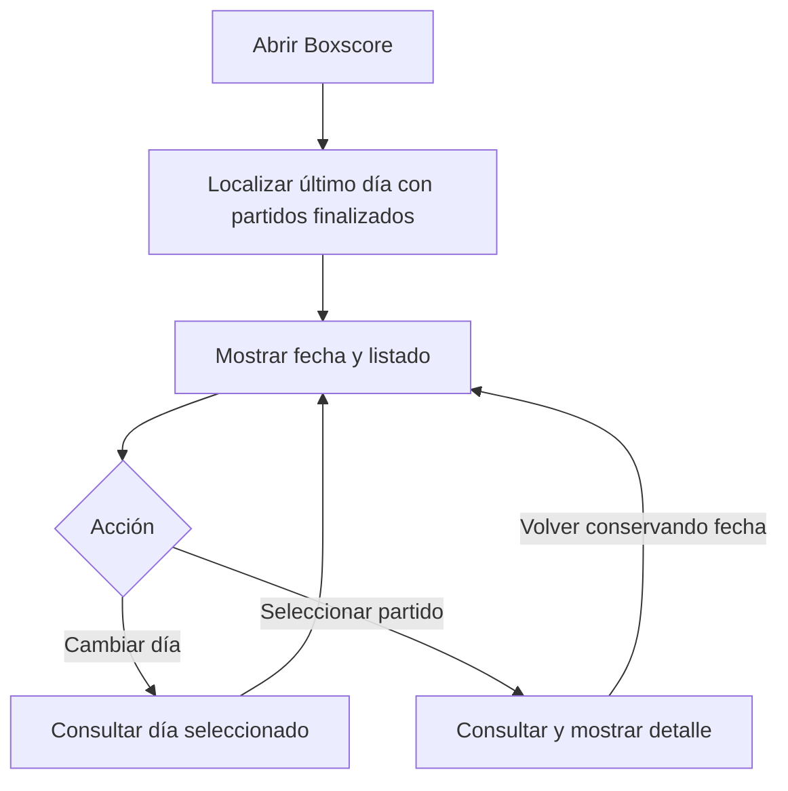

# Boxscore — Especificación inicial de requisitos

| Control documental | Valor |
|---|---|
| Versión | 0.4 |
| Fecha | 01/11/2026 |
| Estado | Borrador consolidado; pendiente de aprobación para implementación |
| Responsable | Diego Gómez Sánchez — responsable del proyecto y desarrollador |
| Ámbito | Propuesta de primer incremento funcional |

## 1. Propósito

Especificar un primer incremento para consultar partidos NBA finalizados mediante un listado diario y una página de detalle. Boxscore es un proyecto personal de formación desarrollado de manera unipersonal.

Este documento no acredita implementación, pruebas superadas ni una integración de datos autorizada. Los requisitos se presentan como propuestas mientras no exista un registro de aprobación contrastado. No se afirma que hayan sido rechazados ni que no existan pruebas previas.

## 2. Referencias y estados

| ID | Referencia | Uso |
|---|---|---|
| REF-01 | `PROYECTO_CONTEXTO.md` y `ESTADO_PROYECTO.md`, consultados en GitHub antes de esta actualización, commit `6855fdd3e6e4b5489fa3005a8ed61c6fa5653307`. | Marco, restricciones y estado registrado. |
| REF-02 | Borradores de requisitos 0.2 y 0.3, entregados en la sesión del 01/11/2026. | Antecedentes de redacción, no evidencia independiente de acuerdos ni pruebas. |

- Registrado: criterio recogido en documentos maestros, con su estado provisional cuando corresponda.
- Propuesto: contenido sujeto a revisión y aprobación.
- Pendiente: información, evidencia o decisión todavía no cerrada.

Incorporar este documento al repositorio no aprueba sus requisitos. No se declara conformidad con una norma de requisitos ni un nivel de accesibilidad.

## 3. Necesidad y objetivos

### N-01 · Consulta de partidos

Propuesta de necesidad: consultar resultado y estadísticas de partidos desde una interfaz, mediante un recorrido de listado y detalle. Pendiente de contraste externo y conciliación con las hipótesis generales del producto. No procede de una entrevista externa acreditada.

### OBJ-01 · Recorrido funcional

Seleccionar un día, identificar un partido finalizado y consultar su detalle. Las condiciones del apartado 10 permitirán comprobar el comportamiento cuando se apruebe el alcance.

### OBJ-02 · Aprendizaje

Relacionar necesidades, requisitos, interacción, arquitectura, datos, implementación y pruebas, sin introducir funcionalidades únicamente para justificar una tecnología.

## 4. Restricciones registradas

- Presupuesto de 0 euros, sin nuevas suscripciones ni pruebas que se conviertan en pago.
- Prioridad local; demo privada opcional y condicionada.
- Sin fecha obligatoria ni disponibilidad semanal confirmada.
- Stack provisional: Java y Spring Boot, PostgreSQL y React con TypeScript.
- Fuentes, bibliotecas de acceso a datos, proveedores, versiones y alojamiento pendientes de aprobación.

Las condiciones de acceso, visualización y almacenamiento deberán revisarse para el uso previsto. La tecnología elegida no constituye por sí sola una necesidad del usuario.

## 5. Alcance propuesto

### 5.1 Incluido

- Partidos finalizados de la temporada actual.
- Consulta de un día cada vez; apertura en el último día con partidos finalizados.
- Agrupación por fecha de inicio en España peninsular.
- Listado con ambos equipos y resultado final.
- Detalle con resultado, parciales, competición o fase y estadísticas individuales del partido completo.
- Consultas bajo demanda del listado y del detalle seleccionado.

### 5.2 Fuera de este incremento

Partidos futuros o en directo; vistas semanales o mensuales; filtros avanzados; estadísticas individuales por cuarto; vídeos; cuentas, favoritos y alertas; archivo detallado de temporadas anteriores; importaciones periódicas y descarga anticipada de todos los detalles.

Estas exclusiones delimitan la propuesta de incremento. No descartan permanentemente funciones ni sustituyen por sí solas los candidatos generales al MVP registrados en el contexto.

## 6. Requisitos funcionales propuestos

Todos se relacionan con N-01 y OBJ-01. Su antecedente de redacción es REF-02 y permanecen pendientes de aprobación.

| ID | Requisito |
|---|---|
| RF-01 | Al abrir la aplicación, mostrar el último día de la temporada actual con partidos finalizados, su fecha y el listado correspondiente. |
| RF-02 | Permitir seleccionar un día de la temporada actual y consultar sus partidos finalizados. |
| RF-03 | Identificar ambos equipos y mostrar el resultado final en cada elemento del listado. |
| RF-04 | Permitir abrir el detalle del partido seleccionado. |
| RF-05 | Mostrar ambos equipos, resultado final y puntuación por periodo; las prórrogas requieren completar RG-04. |
| RF-06 | Mostrar competición o fase mediante una correspondencia documentada con los datos, sin inferir categorías sin respaldo. |
| RF-07 | Mostrar estadísticas individuales de ambos equipos para el partido completo: minutos, puntos, rebotes totales, asistencias, robos, tapones, pérdidas, tiros de campo anotados e intentados, triples anotados e intentados y tiros libres anotados e intentados. |
| RF-08 | Consultar el listado al abrir o cambiar de día y el detalle al seleccionar un partido, sin descargar anticipadamente todos los detalles. Caché y persistencia pendientes de diseño. |
| RF-09 | Conservar la fecha seleccionada al volver del detalle al listado. |
| RF-10 | Mantener la fecha e informar cuando no haya partidos finalizados para ese día. |
| RF-11 | Diferenciar un fallo de consulta de la ausencia de partidos y permitir reintentar la consulta fallida. |
| RF-12 | Identificar los datos no disponibles sin sustituirlos por cero ni inferir valores sin respaldo. |
| RF-13 | Si no se localizan partidos finalizados en la cobertura definida, informar y finalizar la búsqueda. |

## 7. Reglas de interpretación propuestas

| ID | Regla |
|---|---|
| RG-01 | Asignar cada partido al día de su fecha de inicio convertida a `Europe/Madrid`, no a su fecha estadounidense ni de finalización. |
| RG-02 | Incluir únicamente encuentros finalizados. Documentar la correspondencia con los estados de la fuente antes de integrarla. |
| RG-03 | No interpretar una etiqueta vacía como temporada regular ni como otra categoría concreta. |
| RG-04 | Distinguir cuatro cuartos y periodos de prórroga. Etiquetas y tratamiento de periodos ausentes pendientes de especificación. |
| RG-05 | Definir temporada actual, cobertura y límite de búsqueda antes de implementar RF-01 y RF-13. |

Estas reglas no fijan el esquema de base de datos.

## 8. Calidad propuesta

| ID | Requisito | Comprobación prevista |
|---|---|---|
| RC-01 | Completar listado → detalle → listado mediante teclado, con foco visible y controles identificables. | Prueba manual de interfaz. |
| RC-02 | Comunicar equipos, resultados y estados mediante texto, sin depender exclusivamente de colores o imágenes. | Revisión de interfaz y contenido. |
| RC-03 | Proporcionar estructura, tablas, controles y mensajes comprensibles mediante tecnologías de asistencia. | Herramientas y criterios detallados pendientes. |
| RC-04 | Mantener visible la fecha consultada e identificar inequívocamente el partido en su detalle. | Revisión de pantallas y navegación. |

No se declara conformidad WCAG ni cobertura completa de accesibilidad. Los umbrales de rendimiento y disponibilidad están pendientes; no se incorporan cifras no acordadas.

## 9. CU-01 · Consultar un partido finalizado

Estado: propuesto. Actor: persona que consulta Boxscore; no representa una entrevista real. Objetivo: consultar resultado y estadísticas de un encuentro terminado. Disparador: apertura de la aplicación. Resultado de éxito: detalle del partido seleccionado.

Dependencias: cobertura definida e integración viable. Para datos reales, condiciones revisadas e integración aprobada. Los datos ficticios de prueba deberán identificarse.

### 9.1 Flujo principal

1. Se abre la aplicación.
2. El sistema localiza el último día con partidos finalizados dentro de la cobertura definida.
3. Se muestran la fecha y el listado.
4. El usuario mantiene la fecha o selecciona otro día.
5. Se muestran los partidos finalizados del día consultado.
6. El usuario selecciona un partido.
7. Se consulta y presenta el detalle.
8. El usuario vuelve al listado conservando la fecha.

### 9.2 Alternativas

- Día vacío: mantener fecha e informar.
- Cobertura sin partidos: finalizar la búsqueda e informar.
- Fallo de consulta: mostrar error y permitir reintentar.
- Datos incompletos: señalar campos no disponibles sin inventar valores.

### 9.3 Recorrido conceptual

Diagrama de flujo Mermaid, no diagrama UML formal ni evidencia de implementación. Los estados vacíos y errores se detallan en los requisitos anteriores.

## 10. Condiciones de aceptación propuestas

Comprobaciones futuras; no son pruebas ejecutadas ni superadas. Dependen de aprobar los requisitos relacionados.

| ID | Condición | Trazabilidad |
|---|---|---|
| CA-01 | Un conjunto conocido muestra al abrir el último día con partidos finalizados según España peninsular. | RF-01, RG-01, RG-02, RG-05 |
| CA-02 | La selección diaria muestra solo partidos finalizados del día; incluye casos de medianoche y cambios de horario. | RF-02, RG-01, RG-02 |
| CA-03 | El listado identifica equipos y resultado; seleccionar abre el mismo encuentro. | RF-03, RF-04 |
| CA-04 | Un encuentro de cuatro cuartos muestra resultado y parciales de referencia. Completar el caso de prórroga al cerrar RG-04. | RF-05, RG-04 |
| CA-05 | La fase coincide con la correspondencia documentada; etiquetas vacías no generan categorías inventadas. | RF-06, RG-03, RF-12 |
| CA-06 | Se muestran los campos individuales de ambos equipos; completar reglas de no participación y ausencia antes de cerrar la prueba. | RF-07, RF-12 |
| CA-07 | El listado no solicita anticipadamente todos los detalles; seleccionar un encuentro solicita su detalle. | RF-08 |
| CA-08 | Volver conserva la fecha seleccionada. | RF-09 |
| CA-09 | Día vacío y error simulado se distinguen; el error permite reintentar. | RF-10, RF-11 |
| CA-10 | Valores ausentes se identifican sin sustituirlos por cero. | RF-12 |
| CA-11 | Ausencia de partidos en toda la cobertura finaliza la búsqueda e informa. | RF-13, RG-05 |
| CA-12 | El recorrido se completa con teclado, foco visible y contenido no dependiente de color o imágenes. | RC-01, RC-02 |
| CA-13 | Fecha e identidad del partido son inequívocas durante la navegación. | RC-04 |

La comprobación detallada de RC-03 se definirá antes de considerar completa la evaluación de accesibilidad.

## 11. Evidencia de viabilidad

Esta versión no incorpora registros de ejecución revisados: no acredita versiones de herramientas, identificadores de partidos ni resultados de consultas. Los antecedentes de los documentos maestros conservan sus límites y referencias históricas.

Para registrar una prueba deben identificarse entorno, versiones, consultas, resultados, campos disponibles, casos no cubiertos, limitaciones y ubicación de la evidencia. Evitar secretos y datos personales innecesarios.

Una prueba exploratoria no equivale a aceptación de la aplicación ni acredita por sí sola exactitud, estabilidad, cobertura o permiso de uso. No se afirma el envío de consultas externas ni la recepción de autorizaciones sin su registro.

## 12. Pendientes y riesgos

| ID | Cuestión |
|---|---|
| P-01 | Conciliar esta propuesta con los candidatos al MVP antes de aprobar una línea base. |
| P-02 | Evaluar y aprobar fuente e integración, con viabilidad técnica y condiciones de uso. |
| P-03 | Definir cobertura, temporada y límites de búsqueda. |
| P-04 | Completar prórrogas, no participación y valores ausentes. |
| P-05 | Documentar categorías de competición y fase, traducciones y solapamientos. |
| P-06 | Mantener el criterio registrado de no usar logos ni marcas; cualquier cambio requiere revisión expresa. |
| P-07 | Contrastar utilidad con participantes reales y registrar límites. |
| P-08 | Concretar calidad, accesibilidad y procedimientos de evaluación. |
| P-09 | Resolver caché, persistencia y papel de PostgreSQL en diseño. |
| P-10 | Revisar privacidad y RGPD antes de recoger datos personales de validación. Minimizar y anonimizar no garantiza por sí solo cumplimiento. |

El uso local o privado no constituye por sí mismo autorización para datos de terceros.

## 13. Gestión documental

GitHub es la referencia. El archivo conserva estado de borrador hasta aprobación expresa. Las copias del Project no se sincronizan automáticamente. La actualización conjunta de contexto y estado registra el avance documental, no la aprobación funcional.

Bocetos de listado y detalle: siguiente actividad candidata después de confirmar alcance. No aprueban por sí solos integración ni requisitos pendientes.

### Asistencia automatizada

Se ha utilizado asistencia de IA para estructurar y redactar el documento. La revisión y aprobación corresponden al responsable del proyecto. La asistencia no constituye validación, ejecución de pruebas ni autorización externa.

### Historial

| Versión | Cambio |
|---|---|
| 0.1–0.2 | Borradores inicial y editorial, no incorporados al repositorio mediante esta actualización. |
| 0.3 | Revisión conservadora de afirmaciones no contrastadas, entregada como archivo. |
| 0.4 | Versión preparada para incorporación a GitHub con contexto y estado coherentes; mantiene propuestas, límites y referencias verificables. |
