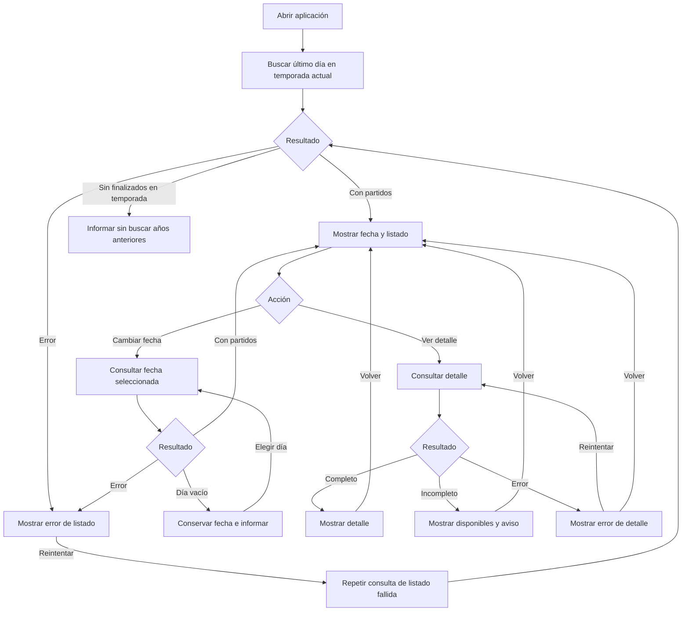

# Boxscore — Requisitos del primer incremento

| Control | Valor |
|---|---|
| Versión | 1.0 |
| Fecha | 01/11/2026 |
| Responsable | Diego Gómez Sánchez — responsable del proyecto y desarrollador |
| Estado | Línea base funcional confirmada; diseño, verificación e integración de datos pendientes |

## 1. Propósito y referencias

Especificar el incremento de consulta diaria de partidos finalizados y detalle de un encuentro. Boxscore es un proyecto formativo de desarrollo unipersonal.

Referencias:
- Versión anterior: commit `10491535f240c3a0d735059c91247bf61a3e3194`, ruta `docs/REQUISITOS.md` (0.5).
- Aprobaciones: confirmaciones expresas del responsable en la sesión del 01/11/2026 sobre núcleo, competiciones, prórrogas, participación, estados de consulta, fechas y terminado; ratificación final de contenido del listado, campos individuales, competición, consulta bajo demanda y claridad/accesibilidad. El registro de origen es la conversación, consolidada aquí; no representa validación externa.
- Seguimiento: issue #1, «Concretar y aprobar los requisitos del primer incremento».

Confirmado significa decisión de producto. No acredita implementación, prueba superada, cobertura técnica ni permiso de uso. Los detalles técnicos abiertos conservan estado pendiente; las ampliaciones no confirmadas siguen siendo propuestas.

## 2. Necesidad y objetivos

N-01: facilitar resultados y estadísticas mediante una interfaz de listado y detalle. Su utilidad con participantes externos sigue pendiente de contraste.

OBJ-01: seleccionar día, localizar un encuentro finalizado, consultar su detalle y volver al listado.

OBJ-02: practicar trazabilidad entre requisitos, interacción, arquitectura, datos, implementación y pruebas, sin añadir funciones solo para justificar tecnologías.

## 3. Restricciones registradas

Presupuesto de 0 euros, prioridad local y demo privada opcional y condicionada. Sin fecha obligatoria ni disponibilidad semanal confirmada. Stack provisional: Java con Spring Boot, PostgreSQL y React con TypeScript; Docker Compose y GitHub Actions prioritarios para aprendizaje; Kubernetes después del MVP.

Fuentes, bibliotecas de acceso, proveedores, versiones y alojamiento no están aprobados. El uso local o privado no constituye por sí solo permiso para datos o recursos de terceros.

## 4. Alcance

### 4.1 Confirmado

Partidos finalizados de la temporada actual: temporada regular, NBA Cup incluida su final, play-in y playoffs incluidas las Finales. Listado diario con selección de fecha y detalle con resultado, parciales y estadísticas individuales de ambos equipos para el partido completo.

Un encuentro no se duplica por tener etiquetas solapadas. Las categorías, estados e identidad de la fuente requieren una correspondencia técnica documentada.

Fuera del primer incremento: pretemporada, All-Star, Summer League, temporadas anteriores, cuentas, favoritos, directos, noticias, gráficas, porcentajes y estadísticas avanzadas. Las estadísticas individuales no se desglosan por periodo. Los logos no son necesarios para identificar equipos y no quedan autorizados.

### 4.2 Propuestas heredadas y ampliaciones

Vistas semanales o mensuales, filtros avanzados, vídeos y alertas no forman parte de las funciones descritas en esta línea base; cualquier incorporación requiere revisar el alcance. No se aprueba importación periódica: el comportamiento confirmado es consulta bajo demanda. Caché y almacenamiento se resolverán en diseño y según condiciones de uso.

Las hipótesis generales del portal se conservan para evolución futura, no como compromisos adicionales.

## 5. Requisitos funcionales confirmados

Todos se relacionan con N-01 y OBJ-01. Se conserva la numeración anterior. Las correspondencias técnicas pendientes no cambian la aprobación del comportamiento esperado.

| ID | Requisito |
|---|---|
| RF-01 | Al abrir, mostrar el último día con partidos finalizados de la temporada actual, su fecha y listado. |
| RF-02 | Permitir seleccionar cualquier día de esa temporada hasta el día actual y consultar únicamente sus partidos finalizados. |
| RF-03 | Cada partido del listado mostrará el nombre de ambos equipos diferenciando local y visitante, resultado final y acción `Ver detalle`. La fecha consultada permanecerá visible sobre el listado. |
| RF-04 | Abrir el detalle del encuentro seleccionado. |
| RF-05 | Mostrar resultado y parciales de ambos equipos: cuatro columnas fijas de cuartos, una por cada prórroga disputada y el total. |
| RF-06 | Mostrar competición o fase disponible mediante etiquetas en español y correspondencia documentada, sin inventar categorías ni duplicar encuentros por solapamiento. |
| RF-07 | Mostrar una tabla de estadísticas individuales por equipo con los campos del apartado 6, para el partido completo. |
| RF-08 | Consultar listado al abrir o cambiar defecha y solicitar detalle al seleccionar un partido, sin descargar anticipadamente todos los detalles de la temporada. |
| RF-09 | Volver del detalle al listado conservando la fecha seleccionada. |
| RF-10 | Mantener el día elegido y mostrar «No hay partidos finalizados para este día» si no hay resultados, sin saltar automáticamente a otro día. |
| RF-11 | Diferenciar error y ausencia de partidos. Permitir reintentar la consulta fallida; conservar fecha y permitir volver al listado desde un detalle fallido. |
| RF-12 | Distinguir datos ausentes, ceros válidos y no participación según el apartado 7. |
| RF-13 | Si todavía no existen partidos finalizados en la temporada, informar sin buscar temporadas anteriores ni realizar búsquedas indefinidas. |
| RF-14 | Mostrar «Cargando partidos…» o «Cargando detalle…» durante la consulta, sin presentar datos anteriores como si fueran los nuevos. |
| RF-15 | Si el detalle llega incompleto, mostrar los datos disponibles y advertir de la información incompleta. |

## 6. Campos individuales confirmados

| Grupo | Campos |
|---|---|
| Identificación | Nombre del jugador. |
| Participación | Minutos. |
| Estadísticas | Puntos, rebotes totales, asistencias, robos, tapones y pérdidas. |
| Tiros | Tiros de campo, triples y tiros libres: anotados e intentados. |

Una tabla por equipo. Sin porcentajes ni estadísticas avanzadas en este incremento. Aplicar las reglas de ausencias y no participación; no inferir valores para completar campos.

## 7. Reglas confirmadas

| ID | Regla |
|---|---|
| RG-01 | Asignar el día por la fecha de inicio convertida a `Europe/Madrid`, no por la fecha estadounidense ni por la finalización. |
| RG-02 | Incluir solo partidos finalizados; documentar su correspondencia con estados de la fuente antes de integrarla. |
| RG-03 | No interpretar una etiqueta vacía como una competición concreta. |
| RG-04 | Cuartos `1.º`, `2.º`, `3.º`, `4.º`; prórrogas `PR1`, `PR2`, etc.; columna final `Total`. Parcial ausente: `No disponible`, no cero. |
| RG-05 | Limitar la búsqueda inicial a la temporada actual. Su identificación y el límite de consultas son detalles técnicos pendientes. |
| RG-06 | Si la fuente indica expresamente no participación, mostrar al jugador al final de su equipo como `No participó`, sin rellenar estadísticas con ceros. |
| RG-07 | Mostrar motivos recibidos solo con una traducción revisada; no inferir lesiones ni otras causas. |
| RG-08 | Estadística ausente: `—`, con aclaración «Dato no disponible». Cero válido: `0`. Si un jugador no aparece en los datos, no añadirlo ni suponer no participación. |
| RG-09 | Mantener un único encuentro aunque sus etiquetas de competición o fase se solapen. Documentar identidad y correspondencias técnicas. |

Errores: «No se han podido cargar los partidos» y «No se ha podido cargar el detalle», con botón `Reintentar`. Nunca presentar un error como ausencia de partidos.

## 8. Calidad confirmada y límites

| ID | Requisito |
|---|---|
| RC-01 | Completar listado → detalle → listado mediante teclado, con foco visible. |
| RC-02 | No depender exclusivamente de colores o imágenes para comunicar información. |
| RC-03 | Proporcionar controles con nombres comprensibles, tablas con encabezados identificables y estructura y mensajes preparados para tecnologías de asistencia. |
| RC-04 | Mantener fecha y partido claramente identificados durante la navegación. |

El procedimiento detallado de evaluación mediante tecnologías de asistencia queda pendiente. No se declara conformidad WCAG ni accesibilidad completa. Rendimiento y disponibilidad no tienen todavía objetivos cuantitativos aprobados.

## 9. CU-01 · Consultar un partido finalizado

Actor: persona que consulta Boxscore, no participante externo acreditado. Resultado de éxito: detalle del encuentro seleccionado.

1. Abrir la aplicación.
2. Localizar el último día con finalizados de la temporada actual y mostrar fecha y listado.
3. Mantener fecha o seleccionar otra dentro del intervalo permitido.
4. Seleccionar un partido y consultar detalle.
5. Volver al listado conservando la fecha.

Alternativas: carga visible, día vacío conservado, error con reintento, detalle incompleto con aviso y temporada sin finalizados sin buscar años anteriores.

Diagrama conceptual de flujo, no UML formal ni evidencia de implementación:

Los estados de carga acompañan cada consulta. La fecha y el contexto de la consulta fallida se conservan al reintentar.

## 10. Condiciones de aceptación

Comprobaciones futuras, no pruebas ejecutadas o superadas. Se conserva la numeración.

| ID | Comprobación | Relación |
|---|---|---|
| CA-01 | Abrir un conjunto conocido y localizar último día con finalizados según España peninsular. | RF-01, RG-01, RG-05 |
| CA-02 | Comprobar selección e inicio local con medianoche y cambios horarios; no admitir fechas fuera del intervalo. | RF-02, RG-01 |
| CA-03 | Mostrar equipos local/visitante, resultado, fecha y acción; abrir el mismo encuentro seleccionado. | RF-03, RF-04 |
| CA-04 | Comprobar partido sin prórroga, con una y con varias; columnas, total y parcial ausente. | RF-05, RG-04 |
| CA-05 | Etiquetas en español según correspondencia, sin categoría inventada ni duplicación por solapamiento. | RF-06, RG-03, RG-09 |
| CA-06 | Tablas de ambos equipos con campos del apartado 6; no participación, motivos, jugador no recibido, cero y ausencia diferenciados. | RF-07, RF-12, RG-06 a RG-08 |
| CA-07 | Listado sin descarga anticipada de todos los detalles; selección solicita el detalle del partido. | RF-08 |
| CA-08 | Volver desde detalle o error conserva fecha. | RF-09, RF-11 |
| CA-09 | Día vacío y error son distintos; reintentar conserva contexto. | RF-10, RF-11 |
| CA-10 | Diferenciar `0`, `—` y `No disponible` según dato. | RF-12, RG-04, RG-08 |
| CA-11 | Temporada sin finalizados: informar, terminar búsqueda y no consultar temporadas anteriores. | RF-13, RG-05 |
| CA-12 | Recorrido con teclado, foco visible e información no dependiente solo de color o imágenes. | RC-01, RC-02 |
| CA-13 | Fecha y encuentro inequívocos durante navegación. | RC-04 |
| CA-14 | Carga correcta sin mostrar resultados anteriores como nuevos. | RF-14 |
| CA-15 | Detalle parcial conserva disponibles y muestra aviso. | RF-15 |
| CA-16 | Cobertura de todas las fases incluidas, exclusiones correctas y ausencia de duplicados. | Apartado 4 |
| CA-17 | Controles nombrados, encabezados de tabla identificables, estructura y mensajes evaluados con el procedimiento de asistencia que se defina. | RC-03 |

CA-05, CA-16 y otros casos de datos reales requieren verificar la cobertura y correspondencias de la integración. Datos ficticios identificados permiten escenarios controlados, no acreditar cobertura real. Completar el procedimiento de CA-17 y sus evidencias antes de declarar verificada esa condición.

## 11. Terminado confirmado

- Recorrido de listado, fecha, detalle y vuelta conforme a los requisitos.
- Casos comprobados de partido sin prórroga, con prórroga, jugador sin participación y estadísticas ausentes.
- Estados comprobados de carga, día vacío, error con reintento y detalle incompleto.
- Recorrido por teclado, foco visible e información no dependiente solo de color o imágenes.
- Pruebas registradas con resultado y limitaciones.
- Documentación acorde con lo implementado y pendientes identificados.
- Para declarar terminado con datos reales: integración aprobada tras revisar técnica y condiciones de uso. Demo ficticia identificada no cierra esa comprobación.

No equivale a cumplimiento completo de accesibilidad ni fija rendimiento. La línea base funcional permite preparar bocetos; la integración real queda condicionada a su evaluación específica.

## 12. Pendientes técnicos y riesgos

1. Fuente, biblioteca e integración; cobertura de competiciones, estados e identificadores.
2. Identificación técnica de temporada actual y límite de búsqueda.
3. Mapa de categorías y traducciones revisadas, incluidos motivos de no participación.
4. Caché, almacenamiento y función de PostgreSQL según diseño y condiciones de uso.
5. Procedimiento de accesibilidad y pruebas; objetivos de rendimiento y disponibilidad.
6. Contraste externo de utilidad; privacidad antes de recoger datos personales. Minimización o consentimiento no garantizan por sí solos cumplimiento del RGPD.
7. Derechos de datos y recursos de terceros; sin autorización de logos ni marcas.

No se incorporan registros técnicos nuevos ni se acreditan pruebas, versiones, consultas externas, autorizaciones o entrevistas. Las evidencias históricas conservan sus límites.

## 13. Gestión y asistencia

GitHub es referencia documental; las copias del Project no se sincronizan automáticamente. La issue #1 se actualizará y cerrará solo mediante una operación separada autorizada y tras comprobar la publicación. El documento de seguimiento contiene el texto preparado, no evidencia de envío.

Asistencia de IA para redacción. Revisión y aprobación bajo responsabilidad del responsable del proyecto; no acredita pruebas ni permiso externo.

| Versión | Cambio |
|---|---|
| 0.1 a 0.3 | Borradores previos fuera del repositorio. |
| 0.4 | Especificación inicial en GitHub. |
| 0.5 | Acuerdos de alcance, comportamientos y terminado. |
| 1.0 | Ratificación final de listado, campos, competición, consulta y claridad/accesibilidad; línea base funcional con pendientes técnicos separados. |
