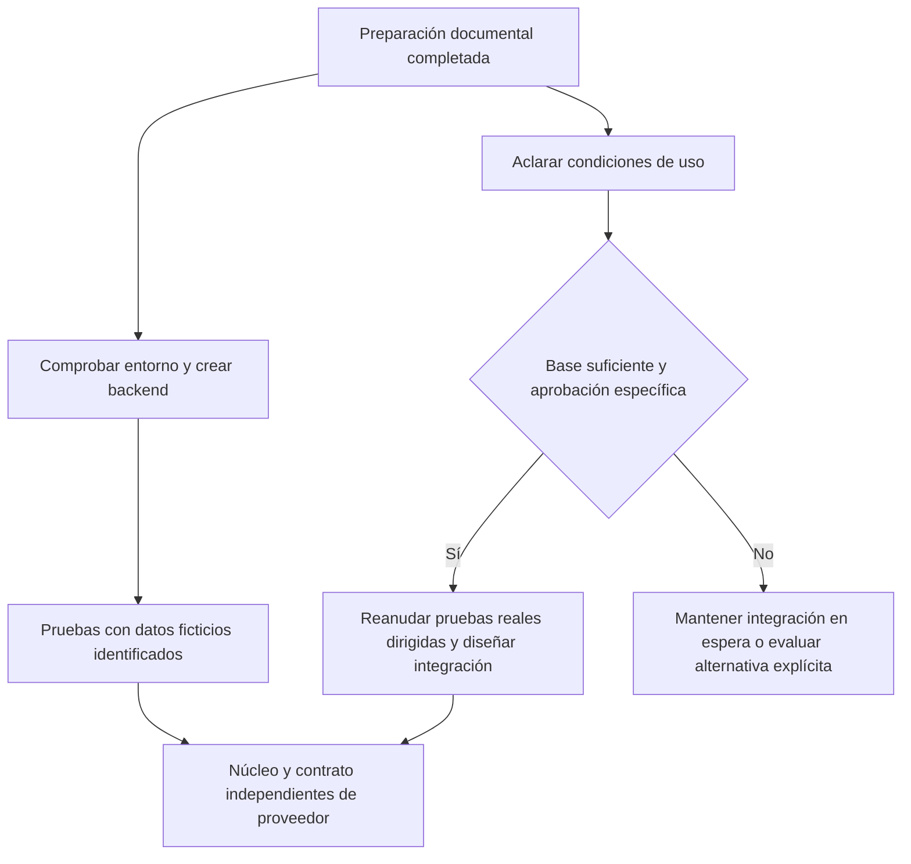

# Boxscore — Revisión inicial de viabilidad de datos

| Control | Valor |
|---|---|
| Versión | 1.0 |
| Fecha de revisión | 01/11/2026 |
| Responsable | Diego Gómez Sánchez — responsable del proyecto y desarrollador |
| Alcance | Evidencia exploratoria aportada y condiciones públicas relevantes para el incremento |
| Conclusión | Viabilidad técnica parcial observada; uso e integración NBA no aprobados |

## 1. Resumen y decisión operativa

Las consultas aportadas permiten estudiar listado y detalle de un caso. No prueban cobertura de temporada, estabilidad o exactitud independiente.

La FAQ oficial NBA Stats afirma que las estadísticas no están disponibles para descarga académica o personal. Los términos contienen usos limitados, atribución y restricciones adicionales, incluidas bases completas regularmente actualizadas que requieren consentimiento previo. No hay base suficiente para presentar Boxscore con nba_api como integración autorizada.

Criterio de continuación de este paquete: mantener la integración NBA en espera, sin nuevas consultas para el producto ni publicación de originales; avanzar en entorno y backend con datos ficticios identificados para pruebas. No cambia el objetivo de evaluar datos reales ni permite declarar terminado el incremento real. No se eluden restricciones ni se busca otro endpoint como forma de evitar las condiciones.

No es asesoramiento jurídico ni una declaración de que toda consulta posible sea ilícita. La limitación es no aprobar el caso de uso sin aclaración suficiente.

## 2. Uso previsto evaluado

Proyecto personal formativo, no comercial, local y unipersonal. Listado diario y detalle de finalizados de temporada actual, incluidos regular, Copa, play-in y playoffs. Consultas bajo demanda; sin directo, play-by-play, cuentas, apuestas, fantasy o publicidad. Demo privada opcional, no aprobada. Caché y almacenamiento todavía sin decidir.

No se utiliza la ausencia de persistencia como prueba automática de permiso. Tampoco se interpreta privado/no comercial como excepción a todas las restricciones.

## 3. Fuentes públicas verificadas

Consultadas el 01/11/2026. Se registra fecha de consulta, no se atribuye una fecha de versión de los términos que no se haya verificado. Las páginas pueden cambiar; esta revisión no es una copia íntegra certificada.

| ID | Fuente | Contenido relevante |
|---|---|---|
| PUB-01 | [Términos NBA.com](https://www.nba.com/termsofuse), secciones 1, 9 y 12. | Restricciones de contenido; atribución prominente NBA.com; usos legítimos de noticias o privados no comerciales; restricciones comerciales, apuestas, fantasy y play-by-play; consentimiento previo para bases completas y actualizadas; canal de contacto. |
| PUB-02 | [FAQ NBA Stats](https://www.nba.com/stats/help/faq). | Indica que estadísticas no están disponibles para descarga académica o personal y que son para consulta en NBA.com/Stats. |
| PUB-03 | [README de nba_api](https://github.com/swar/nba_api). | Proyecto independiente, MIT para software; datos sujetos a términos NBA.com; advertencias técnicas de cambios, límites e IP de nube. |

Extractos breves relevantes, conservados en su idioma original:

PUB-02: “Our stats are not available for download for either academic or personal use.”

PUB-01: “any use, display, or publication of the NBA Statistics shall include a prominent attribution to NBA.com”.

PUB-03: “Data retrieved with this package comes from NBA.com and is subject to the NBA.com Terms of Use.”

La licencia del cliente y la disponibilidad técnica de endpoints no conceden derechos sobre los datos. Las recomendaciones técnicas de una biblioteca no sustituyen las condiciones del titular.

## 4. Lectura aplicada y límites

| Punto | Resultado de revisión |
|---|---|
| Atribución | Obligación expresa en términos para uso de estadísticas; no basta por sí sola para autorizar el resto. |
| Privado/no comercial | Uso mencionado con límites; no permite ignorar FAQ u otras restricciones. |
| Descarga personal/académica | Señal restrictiva expresa de la FAQ; requiere aclarar aplicabilidad a consulta automatizada y visualización local. |
| Temporada completa y actualizaciones | Riesgo relevante de la cláusula de base completa/actualizada; no se afirma que consulta bajo demanda evite su aplicación. |
| Sin caché o sin BD | No equivale a autorización; no se ha verificado una excepción. |
| Demo privada | No se declara uso permitido; requiere aclarar alcance y destinatarios. |
| stats.nba.com y CDN | Ámbito exacto del acceso automatizado no aclarado por esta revisión; no atribuir licencia de API por ausencia de clave. |
| Logos/recursos | No aprobados; mantener fuera. |

Existe tensión entre una lectura amplia de usos privados permitidos en términos y la respuesta específica de la FAQ sobre descarga. Esta revisión no decide unilateralmente su jerarquía o resolución jurídica: adopta una posición operativa conservadora y deja el uso sin aprobar.

No se verifican autorizaciones individuales, términos específicos de endpoints adicionales ni condiciones de proveedores alternativos. Tampoco se acredita envío de consulta anterior o respuesta recibida.

## 5. Evidencia técnica aportada

### 5.1 Procedencia

TXT adjunto y salidas de PowerShell pegadas por el responsable en la sesión. Son registros aportados, no ejecución independiente del revisor. Originales conservados fuera del repositorio en este paquete. No copiar rutas de usuario ni resultados completos de terceros al repositorio mientras el uso siga sin aclarar.

### 5.2 Resultados observados

| Prueba aportada | Observación | Límite |
|---|---|---|
| BoxScoreTraditionalV3, un encuentro | Estadísticas de ambos equipos con los campos del incremento; aparece una fila con minutos vacíos. | No prueba no participación explícita, motivos o exactitud independiente. |
| BoxScoreSummaryV3, mismo encuentro | Resultado, cuatro cuartos, Final, inicio UTC y IDs local/visitante. | Sin caso de prórroga. |
| Conversión con zoneinfo | Conversión de una fecha UTC a Europe/Madrid registrada. | No demuestra agrupación completa de un día ni todos los cambios horarios. |
| ScoreboardV3, una fecha | Diez partidos finalizados, marcadores y etiquetas de Copa/grupo. | No cobertura general de fases o temporada. |
| JSON original de un encuentro del listado | homeTeam y awayTeam explícitos, nombres, IDs, marcador y periodos. | Solo una muestra revisada; no basarse en orden de filas. |
| Comando de versiones actual | Python 3.13.14 y nba_api 1.12.0. | No acredita retrospectivamente versiones del TXT anterior. |

La consistencia entre salidas de listado y detalle en el encuentro revisado es observada, no una verificación oficial independiente. Los resultados no equivalen a pruebas de aceptación de Boxscore, todavía no implementado.

### 5.3 Pendientes técnicos

Prórrogas; no participación explícita y motivos; otras fases; agrupación completa por inicio español, deduplicación y límites de búsqueda. No repetir casos ya aportados sin objetivo. Reanudación de pruebas reales condicionada a aclaración y aprobación de uso, no a producir más documentación.

## 6. Continuación separada de la integración real

No se instala ninguna dependencia ni se elige versión con este informe. No se aprueba persistencia. El acceso real puede permanecer desacoplado mientras se practica el núcleo; los fixtures no se presentan como NBA real ni como validación del producto con participantes.

## 7. Consulta de aclaración preparada, no enviada

Canal de contacto publicado en PUB-01, sección 12: `FanRelations@NBA.com`. No se garantiza que sea el órgano que autoriza licencias; se solicita derivación si corresponde. No enviar automáticamente, no adjuntar repositorio privado ni datos personales innecesarios.

Asunto propuesto: Clarification of NBA Stats data use for a private non-commercial learning project

Texto propuesto:

Hello,

I am developing a personal, non-commercial software learning project, initially running only on my own computer. It would display completed NBA games from the current season, with daily results, period scores and traditional player statistics. It would not include live play-by-play, betting, fantasy features, advertising or commercial sponsorship.

Before implementing an integration, I would like to clarify the applicable permissions. The NBA Stats FAQ states that statistics are not available for download for academic or personal use, while section 9 of the NBA.com Terms of Use refers to private, non-commercial uses subject to restrictions.

Could you confirm whether automated, on-demand requests to stats.nba.com or NBA data feeds for this local display are permitted? Would the answer differ if no persistent database is created? What restrictions apply to temporary caching, storing selected game results or box scores, or displaying all completed games from the current season?

Would a restricted demonstration to a small number of participants require separate permission? What attribution and any additional endpoint-specific terms would apply?

If this request should be addressed to a licensing or legal team, please let me know the appropriate contact. I will not treat technical access, absence of an API key or lack of a response as permission.

Thank you.

No firma ni destinatarios adicionales elegidos. Este borrador no demuestra que el mensaje se haya enviado ni que exista autorización. Una respuesta deberá evaluarse por su contenido y alcance; el silencio no cierra el pendiente.

## 8. Coste, riesgos y criterio de cierre

Presupuesto de 0 euros; no contratar licencias ni activar pruebas con pago automático. Una alternativa solo se elegirá después de evaluar coste, cobertura y condiciones, no como cambio silencioso de alcance.

Riesgos: términos incompatibles, cobertura limitada, cambios de endpoints, restricciones de red y datos ausentes. Tratar con revisión de uso, interfaz sustituible, pruebas dirigidas y límites explícitos. No eludir bloqueos o controles.

Esta revisión documental inicial queda completa dentro de su alcance. La autorización de integración permanece abierta; no se puede completar por redacción. Para aprobar datos reales hacen falta una base de uso suficiente, evaluación técnica dirigida y decisión expresa del proyecto.

## 9. Asistencia

Asistencia de IA para investigación y redacción. Las fuentes se distinguen de la interpretación y de los registros aportados. Responsabilidad de revisión y aprobación del responsable del proyecto. No es asesoramiento jurídico.
